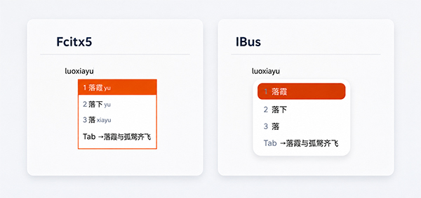

# 言泉输入法 Linux 版（Cassotis IME for Linux）

<p align="center">
  
</p>

<p align="center">
  <a href="https://www.yanquan.org">
    <picture>
      <source media="(prefers-color-scheme: dark)" srcset="readme_slogan_dark.svg">
      
    </picture>
  </a>
</p>

<p align="center">
  <a href="https://www.yanquan.org"></a>
  <a href="https://github.com/shenmin/cassotis-ime-linux/releases/latest"></a>
  <a href="LICENSE"></a>
  <a href="https://github.com/shenmin/cassotis-ime-linux/actions/workflows/ci.yml"></a>
</p>

<p align="center">
  
</p>

**[官网 www.yanquan.org](https://www.yanquan.org)** | [English](README.md) | 简体中文 | [Windows 版](https://github.com/shenmin/cassotis-ime) | [macOS 版](https://github.com/shenmin/cassotis-ime-mac)

言泉输入法 Linux 版是面向 Linux 桌面的实验性中文拼音输入法。原生 IBus 与 Fcitx 5 适配器共用同一套 Free Pascal 引擎服务；核心引擎移植自[言泉输入法 Windows 版](https://github.com/shenmin/cassotis-ime)，词库由 [Cassotis Lexicon](https://github.com/shenmin/cassotis-lexicon) 构建。候选排序完全在本机 CPU 上完成，以项目自训的本地字符级语言模型为核心。软件无广告、无捆绑组件，不上传任何输入内容，词库、配置与用户学习数据均保存在本地。

当前版本为 2.9.0，与言泉输入法 Windows 版及 Cassotis Lexicon v2.9.0 保持同步。历次更新见下文[版本历史](#版本历史)与[更新日志](CHANGELOG.md)，安装包可在 [Releases](https://github.com/shenmin/cassotis-ime-linux/releases) 下载。

项目当前目标：
- 同步跟进 Windows 版发布，并通过同一套基准测试验证跨平台一致性；
- 原生集成 GNOME、KDE 等桌面环境下的 IBus 与 Fcitx 5 框架；
- 提供离线可用、无需 GPU 的 amd64 与 arm64 安装包。

## 名称来源
英文名 **Cassotis** 取自古希腊 Delphi 神庙内的圣泉。传说女祭司皮媞亚（Pythia）在传达神谕前会饮用此泉之水以获灵感；圣泉象征语言与灵感的源头，也暗合项目从 Delphi 走向自然语言的渊源。

中文名 **言泉** 既对应 Cassotis 的圣泉意象，也取“言如泉涌”之意，寄托流畅、自然的中文输入体验。

## 主要特性
- **IBus 与 Fcitx 5**：两个适配器连接同一后台引擎服务，共用配置、词库与用户学习数据；同一桌面会话只需启用其中一个框架。
- **候选面板**：由 IBus 或 Fcitx 5 原生绘制并跟随桌面主题；每页显示 3 至 9 个候选（默认 9 个），支持 `-/+`、`[/]`、`,/.` 或 `Shift+Tab/Tab` 翻页。“外观”设置支持自动、固定竖排或固定横排布局，详见[候选布局](CONFIGURATION.CN.md#候选)。
- **英文识别**：中文全拼半角模式下，常见英文单词与专有名词（如 `pro`、`markdown`、`Effie`）、含大写字母的输入，以及曾直接按字母上屏的词条，会作为无编号候选排在数字候选之前。无对应整词中文读音时默认高亮，按空格直接上屏；若同时存在中文读音（如 `bug`、`mac`），则由语言模型结合上文判断优先级。数字候选编号保持不变，直接上屏的英文不会写入中文用户词库。该功能默认开启，可在设置中关闭；双拼模式仍按常规中文输入处理。
- **一键补全**：在常规候选之外单独提供一条高置信度续写建议，按设定的 `Tab` 或反引号键即可上屏。词库前缀补全与高频词间转移结果即时显示，语言模型随后在后台完成重排或续写扩展；置信度不足时不显示提示。
- **诗词补全**：输入已收录诗句的开头可补全整句；完整输入上句后，可直接提示带标点的下一句原诗。
- **长句**：基于词库约束的路径搜索生成整句候选（如 `womenjintian` → `我们今天`），同时保留前缀词与单字供分段选词。语言模型对整句候选评分选优后，会结合输入拼音与前文进一步修正少量同音字。
- **短词**：存在多个精确匹配词条时，综合语言模型评分与通用语料词频排序，并在有前文时结合上下文消歧。无上文输入时，兼顾通用词频与日常对话词频，避免低频词仅凭模型打分压过常用词；有上文时，单音节单字候选同样按上下文重排。
- **繁体输入**：候选与上屏结果采用台湾繁体字形；语言模型评分与后台补全内部映射为对应简体文本计算，避免繁体字形导致评分偏差。
- **短语**：对于未收录在词库中的三至五音节输入（如 `jiuguize` → `旧规则`），引擎先由基础词条组合出候选短语，再由语言模型结合前文选优并完成同音纠错；手动选择的非首选短语会自动记入用户词库。
- **拼音方案**：支持全拼、首字母简拼（如 `jt` → `今天`）及七种双拼方案（微软、小鹤、自然码、搜狗、紫光、拼音加加、智能 ABC），共享同一套排序与用户学习数据；11 组模糊音可独立开关。支持以 `lue`/`nue` 输入 `lve`/`nve`、以 `jv`/`qv`/`xv` 输入 `ju`/`qu`/`xu`；未启用二三候选键时，`'` 用作音节分隔符。
- **二三候选键**：可选启用 `;` 与 `'` 快速选择当前页第二、第三候选（默认关闭）。双拼模式下，分号位于音节第二键时仍优先作为韵母键处理。详见[二三候选键](CONFIGURATION.CN.md#二三候选键)。
- **词库与学习**：简体基础词库、繁体基础词库与用户词库相互独立。用户自学习词条通过 OpenCC 随当前简繁模式自动转换显示；高亮选中已学习候选后按 `Ctrl+Delete` 可将其删除。
- **文档内适应**：利用输入法框架提供的光标周边文本，临时提升当前文档内高频词与上下文续写的优先级。相关上下文仅驻留内存，按输入焦点隔离，不写入磁盘。
- **用户词管理**：可在“高级”页导入个人词频、导出用户词表，按词语或拼音搜索并删除选中的学习记录。删除不影响基础词库，不会给原词降权。IBus 和 Fcitx 5 共用结果。详见[导出与管理用户词](CONFIGURATION.CN.md#导出与管理用户词)。
- **快捷输入**：支持 `ufh` 符号、`uxh` 序号、`usx` 数学符号、`ujt` 箭头、`udw` 单位、`ubd` 中文标点，以及 `urq`/`usj`/`uxq` 当前日期、时间与星期输入；输入 `i123.45` 或 `v123.45` 可转换中文数字与金额大写。双拼模式下通过 `Shift+U/I/V` 触发。详见[快捷输入说明](CONFIGURATION.CN.md#快捷输入)。
- **中文标点**：在中文标点半角模式下，紧跟数字输入的句号自动转为半角小数点；支持自定义保持半角输出的符号集合（默认启用 Markdown 预设 ``-#*+_=`~[]<>|@``），逗号、句号、圆括号和引号仍输出中文标点。
- **设置**：GTK 设置侧栏将候选操作与功能快捷键分开。“按键”管理翻页、选词和补全；“快捷键”管理中英文切换等操作，关闭某项不会丢失原有绑定。
- **自定义短语**：通过字母编码快捷输入常用短语、地址或多行文本。编码精确匹配时显示在补全栏，按设定的 `Tab` 或反引号键原样上屏，不影响常规数字候选，也不会记入用户词库。设置界面支持调整顺序与 JSON 导入导出，诊断选项集中于“高级”页。详见[自定义短语](CONFIGURATION.CN.md#自定义短语)。
- **完全本地**：全程离线运行，无需联网或 GPU。首个按键即可返回基础词库候选；语言模型后台加载期间或缺失时，输入法仍可正常出词，仅跳过模型重排。

## 下载与安装

请在 [GitHub Releases](https://github.com/shenmin/cassotis-ime-linux/releases) 下载安装包及对应的校验信息。所有安装包均内置 IBus 与 Fcitx 5 适配器、基础词库和语言模型。请根据系统环境选择安装方式：

| 系统环境 | 下载格式 | 安装方式 |
| --- | --- | --- |
| 依赖兼容的 Debian、Ubuntu 及衍生发行版 | `.deb` | [APT 安装](#debian-installation) |
| SteamOS 桌面模式等系统目录只读的环境 | `.tar.gz` | [用户目录安装（无需 sudo）](#user-installation) |
| 运行库兼容且系统目录可写的其他发行版 | `.tar.gz` | [便携包系统级安装](#system-installation) |

便携包内的二进制文件与同架构 `.deb` 包一致，均为动态链接产物，依赖兼容的系统运行库，并非跨发行版静态通用包。安装前请先执行便携安装器的依赖预检；若系统运行库不兼容，请从源码构建。所有升级与卸载流程均会保留用户词库和个人配置。

<a id="debian-installation"></a>

### Debian / Ubuntu：APT 安装

下载与系统架构一致的 `.deb` 安装包，将本地计算的 SHA-256 与 Release 页面提供的摘要核对无误后，使用 APT 安装：

```bash
arch="$(dpkg --print-architecture)"  # 输出 amd64 或 arm64
package="cassotis-ime_2.9.0_${arch}.deb"
sha256sum "${package}"
sudo apt install "./${package}"
```

安装完成后会自动刷新当前活动的 IBus 与 Fcitx 5 会话。在基于 IBus 的 GNOME 桌面中，Cassotis 会直接加入输入源列表，无需重启或注销，也不会改动当前激活的输入源；若安装时未运行图形会话，则会在下次登录时自动加载。按 `Super+Space` 切换至 **Cassotis 言泉拼音输入法** 即可使用。

若使用 Fcitx 5，请先将桌面输入法框架设为 Fcitx 5，再通过 `fcitx5-configtool` 添加 Cassotis。系统中可同时安装 IBus 与 Fcitx 5，但同一桌面会话应仅启用其中一个框架。

可通过 GNOME 输入源中 Cassotis 的“首选项”或 `fcitx5-configtool` 中的配置入口打开设置界面，也可直接运行 `/usr/libexec/cassotis-ime/cassotis-settings`。版本升级可直接用上述命令安装新版软件包；卸载请执行 `sudo apt remove cassotis-ime`。

升级过程会刷新输入法框架。若升级前已打开的应用暂时无法呼出中文输入，保存内容后重启该应用即可恢复连接。

<a id="user-installation"></a>

### SteamOS 等只读系统：用户目录安装

下载与 `uname -m` 架构一致的便携包（`x86_64` 或 `aarch64`）并核对 SHA-256。在 SteamOS **桌面模式**或其他只读根文件系统环境中，可将程序安装至当前用户目录。请勿混用旧版安装脚本，也不要执行 `sudo ./install.sh`。安装前请先结束当前未上屏的拼音输入，再以当前桌面用户身份在终端执行以下命令（**切勿使用 `sudo` 或 `su`**）：

```bash
arch="$(uname -m)"  # 输出 x86_64 或 aarch64
archive="cassotis-ime-linux-2.9.0-${arch}.tar.gz"
sha256sum "${archive}"
tar -xzf "${archive}"
cd "cassotis-ime-linux-2.9.0-${arch}"
./install.sh --user --check &&
./install.sh --user
```

`--check` 仅执行环境预检，通过后才会开始安装。默认自动匹配框架时，KDE 优先选用已安装的 Fcitx 5，GNOME 优先选用 IBus；也可通过 `--framework fcitx5` 或 `--framework ibus` 手动指定（预检与安装两条命令需传入相同参数）。安装器会在校验系统架构、动态库/ABI 兼容性及框架版本后复制文件：运行文件安装至 `~/.local/libexec/cassotis-ime`，词库安装至 `${XDG_DATA_HOME:-$HOME/.local/share}/cassotis-ime`，不写入 `/usr`，也无需解除系统只读保护。目标输入法框架须事先安装并在桌面会话中启用，安装器不会自动安装系统依赖或切换框架。

安装完成后在当前输入法框架中添加 Cassotis；若列表未及时刷新，重启框架或重新登录桌面即可。设置界面也可通过 `~/.local/libexec/cassotis-ime/cassotis-settings` 启动。

便携包内置独立的 OpenCC 运行库与转换数据，仅在宿主系统缺失 OpenCC 时作为回退启用，不会覆盖系统动态库。该方案已在 SteamOS 3.8.14（KDE X11、IBus 1.5.32）下完成安装、升级、卸载与输入验证；SteamOS 游戏模式及 SteamOS 上的 Fcitx 5 暂未纳入验证范围。若预检提示动态库不兼容或 Fcitx 版本过低，请针对目标发行版从源码编译，切勿通过关闭系统只读保护强行安装。详见[用户目录安装与卸载](BUILD.md#portable-user-installation)。

升级时解压新版便携包，以同一桌面用户重新执行上述预检与安装命令。卸载请运行 `./uninstall.sh --user`（**不要加 `sudo`**），该脚本仅清理安装清单中未被修改的文件。请勿将系统级安装、源码用户级安装与便携包用户级安装混用叠加。

<a id="system-installation"></a>

### 其他系统：便携包系统级安装

仅适用于系统目录可写、具备管理员权限且运行库兼容的发行版。SteamOS 等只读系统请改用上文[用户目录安装](#user-installation)。

**切勿使用 v2.1.0 及更早版本便携包的系统级安装脚本。** 旧版脚本可能改写系统目录的属主、权限及 SELinux 安全上下文，导致桌面无法登录。请务必使用 v2.5.0 及以上版本的便携包，或改用用户目录安装。新版安装器通过 `install-support/system_install.py` 保留既有系统目录属性；在启用 SELinux 的系统上需预装 `restorecon`（通常由 `policycoreutils` 提供）。

在解压后的新版便携包目录中执行：

```bash
if test -r install-support/system_install.py; then
    sudo ./install.sh --system
else
    printf 'Use a fixed portable installer or --user installation.\n' >&2
fi
```

便携安装器不会自动安装系统运行库依赖，依赖列表见 [BUILD.md](BUILD.md)。卸载请执行 `sudo ./uninstall.sh`。

新版安装器仅避免写入时破坏目录属性，无法自动还原旧版脚本已损坏的系统目录。若系统已出现无法登录等问题，请先使用发行版自带的恢复工具修复目录权限与安全上下文，切勿以关闭 SELinux 或递归修改权限代替修复。

## 架构
- `src/engine`：拼音解析、候选生成、排序与用户自学习逻辑，移植自 Windows 版引擎。
- `src/host`：语言模型推理、同音纠错与后台补全调度；`src/host/native` 包含对接 ONNX Runtime 的 C++20 桥接库及自定义注意力算子。
- `src/service`：供双框架共用的后台引擎服务（`cassotis-engine`），负责 Unix 域套接字通信与空闲内存回收。
- `src/ipc`：前端适配器与引擎服务之间的进程间通信协议。
- `src/dictionary`、`src/common`：SQLite 词库访问、用户词库管理、配置读写与平台基础工具。
- `adapters/ibus`、`adapters/fcitx5`、`adapters/common`：IBus / Fcitx 5 框架适配器及 GTK 3 设置程序。
- `data`：词库数据库 schema 与分块存储的语言模型文件（`data/models/char_lm`）。
- `third_party/onnxruntime`：预编译的 x86_64 与 aarch64 CPU 版 ONNX Runtime 1.20.1 运行库。
- `scripts`、`packaging`：编译、安装与发行打包脚本。
- `tools/control`：引擎服务控制客户端。

## 运行时文件
- `cassotis-engine`：后台共享引擎服务，负责加载词库与语言模型。
- `ibus-engine-cassotis`：IBus 引擎适配器。
- `libcassotis.so`：Fcitx 5 插件库。
- `cassotis-settings`、`cassotis-control`：图形设置程序与服务控制客户端。
- `libcassotis_pinyin_transformer_ort.so`、`libonnxruntime.so.1.20.1` 和 `char_lm/`：推理桥接库、ONNX Runtime 运行库与语言模型目录，仅由 `cassotis-engine` 加载，前端适配器不直接加载。
- `dict_sc.db`、`dict_tc.db`：简体与繁体基础词库，系统级安装位于 `/usr/share/cassotis-ime/`，用户级安装位于 `~/.local/share/cassotis-ime/`。

引擎服务未运行时，各输入法框架均无法进行拼音转换；模型文件缺失时，输入法仍可正常转换候选，仅停用语言模型重排。

## 构建（快速开始）
编译环境要求：Linux x86_64 或 aarch64、Free Pascal 3.2.2、C/C++20 编译器、SQLite 3、OpenCC、Python 3（含 PyGObject 与 GTK 3）以及 IBus 和 Fcitx 5 开发头文件。无需 CMake、CUDA、GPU，也无需系统预装 ONNX Runtime。

```bash
./scripts/check_environment.sh
./rebuild_all.sh
```

`rebuild_all.sh` 会将引擎服务、两个框架适配器、控制客户端与原生推理桥接库编译至 `build/bin/`，并在校验 SHA-256 后将 `data/models/char_lm` 下的模型分块合并为运行时加载的 `char_lm.onnx`。若需将源码编译产物安装到当前桌面用户目录，请先从 [Cassotis Lexicon](https://github.com/shenmin/cassotis-lexicon) 获取对应版本的 `dict_sc.db` 与 `dict_tc.db`，再以普通用户身份（不加 `sudo`）执行：

```bash
./scripts/install_ibus.sh --dictionary /path/to/dict_sc.db \
  --dictionary-traditional /path/to/dict_tc.db
# 或
./scripts/install_fcitx5.sh --dictionary /path/to/dict_sc.db \
  --dictionary-traditional /path/to/dict_tc.db
```

请勿在已安装 `.deb` 系统包的环境中叠加执行源码安装。完整脚本参数与发行打包流程见 [BUILD.md](BUILD.md)。

## 词库流程
基础词库为 [Cassotis Lexicon](https://github.com/shenmin/cassotis-lexicon) 生成的 schema-24 SQLite 数据库，由以下构建产物导入组装：
- 基础词表：`dict_unihan_sc.txt`、`dict_unihan_tc.txt`、`dict_clean_sc.txt`、`dict_clean_tc.txt`
- 语料统计表：词间转移先验、补全先验、通用语料词频、日常对话词频及短词预置提升表

v2.9.0 词库收录简体读音记录 269,924 条（含单字读音 24,163 条）、繁体读音记录 272,681 条（含单字读音 24,353 条），多音字词按读音分别计入；通用词频表覆盖简体 207,342 项、繁体 209,226 项，日常对话词频表覆盖简体 110,903 项、繁体 111,591 项。词库内置经校对的古典诗词与多音字读音，繁体词表及各统计表统一采用台湾正体字形。用户词库位于 `~/.local/share/cassotis-ime/user_dict.db`；引擎启动时优先加载与当前运行版本配套的基础词库，避免误读其他安装方式遗留的旧版词库。数据库结构与路径覆盖环境变量见 [docs/DICTIONARY.md](docs/DICTIONARY.md)。

## 模型与排序

### 语言模型
- **统一本地语言模型**：采用项目自训的约 1.5 亿参数字符级自回归语言模型（11 层、1024 维、12,017 字词表、静态 INT8 量化），统一承担各输入路径的神经评分与纠错任务，涵盖长句整句打分与拼音条件同音纠错、短词消歧与有上文单字排序、词库外短语组句、中英混输消歧、一键补全后台重排，以及长句 `Tab` 续写生成与筛选。模型权重与言泉输入法 Windows 版完全一致；版本升级时会自动清理已淘汰的旧版模型文件。
- **训练语料**：基于独立的中文通用文本与小说语料训练，兼顾常规自回归语言建模与拼音条件建模。自 v2.7.0 起引入日常对话微调：筛选公开对话数据集 LCCC 中最贴近日常交流的十分之一语料继续训练，再与原模型权重等比融合，在提升口语场景表现的同时保持小说与通用文本上的评分水准。所有基准测试样本均严格排除在训练语料之外。
- **长文本训练**：字符模型在离线训练中学习 Qwen3.5-9B-Base 对整句和续写的偏好，同时保留原模型对文本起首的判断。运行时仍只有一个本地模型，不需要加载或访问教师模型。
- **推理结果确定性**：模型采用固定激活范围的静态量化，并配合自定义注意力算子计算，输出与批次划分及前置缓存状态完全无关；长句逐键输入与一次性输入完整拼音得到的候选结果完全一致。
- **内存占用**：在 v2.0.0 实测中，模型加载完成并空闲 5 秒后，引擎服务常驻内存（RSS）在 x86_64 上约为 311 MiB，在 aarch64 上约为 320 MiB（v1.0.0 因包含 Windows v1.31.0 的多套独立模型，常驻内存约为 437 MiB）。上述数值为空闲常驻内存历史实测，不同于基准测试期间的峰值内存。

### 决策模型与统计特征
- 七个轻量决策树结合语言模型评分和词库统计，分别负责长句优选、长句纠错取舍、无上文及有上文短词优选、上下文细节评分、一键补全和 Tab 续写。决策树直接编译进引擎，不增加神经模型文件或推理会话。
- 三个紧凑结构排序模型负责长句路径搜索剪枝与整句候选池初排。
- 词库内置词间转移先验、补全先验、预计算短词提升表，以及通用语料词频与日常对话词频，为排序决策补充词典与语料统计依据。

### 各输入路径的排序流程
- **长句**：词库约束搜索生成整句候选，其中两个轻量排序器负责路径剪枝，第三个排序器对整句候选池初排；随后由语言模型对头部候选打分，经长句决策模型选出前两名候选。最后结合输入音节与光标前最多 48 个字符的上下文执行同音字纠错（必要时执行受限的二次纠错）。简繁体与全拼、双拼均支持该流程；用户词及整串精确匹配的词库词保持原样不作改写。
- **短词**：先由词库预计算的提升表确定基础排序，再由短词决策模型结合语言模型打分与通用语料词频重排；若无上下文评分差距不显著，则进一步结合光标前文评分。无上文时，通用词频比默认首选低十倍以上的候选不会仅凭语言模型分数升至首位；在通用词频与词库权重同样支持默认首选时，显著更高的日常对话词频也会保留该首选。单字候选在有前文时同样按上下文重排。用户个人词频与基础词库信号独立维护。
- **词库外短语**：针对未命中基础词库与用户词库的三至五音节输入，引擎先按不同音节切分方式组合出候选短语，由语言模型评估整句通顺度并选出最优草稿，再结合输入音节完成同音字修正。支持双拼与繁体输入；启用模糊音或显式输入音节分隔符 `'` 时仍走常规切分路径。
- **中英混输消歧**：当输入字母串同时存在中文整词读音时，语言模型结合前文在单次推理中对比原始字母与首页前列的中文整词候选，仅在英文得分明显占优时将其排在首位。
- **一键补全**：词库补全与强转移补全先行即时显示；语言模型随后在后台对更广范围的词库词重排，仅在置信度优势明确时替换当前提示。
- **长句 Tab 续写**：语言模型预测后续字符，综合评估补全当前词或续写下一短语的候选方案，再由 `Tab` 续写决策模型择优展示或抑制低置信度提示。

### 运行机制
- 推理全程通过随包附带的 ONNX Runtime 在本地 CPU 上完成，不访问网络，也不依赖 GPU。
- 语言模型仅由后台引擎服务异步加载；常规候选查询、选词上屏及静态补全均不阻塞等待模型就绪。
- 前台模型推理限时 100 ms，后台补全限时 120 ms；超时结果直接丢弃并保留已有候选。
- 推理线程数按可用 CPU 核心数配置，x86_64 上限为 6 线程，aarch64 上限为 8 线程。
- 停止输入满 5 秒后，引擎服务自动归还未使用的堆内存页，同时保留已加载模型与上下文状态。

## 基准测试

下表中 `v2.9.0` 数据为当前引擎与词库的原生实测结果，早期版本保留发布时的原始实测数据；框架与打包验证范围见[兼容性记录](COMPATIBILITY.md)。自 v2.0.0 起，语料基准测试关闭搜索、语言模型及补全的墙钟超时限制，统一以 8 个模型线程在同一次完整查询中同时采集准确率与延迟，确定性搜索预算上限保持不变。
测试方法、语料来源与评分规则见 [BENCHMARK.CN.md](BENCHMARK.CN.md)（[English](BENCHMARK.md)）。测试集与言泉输入法 Windows 版一致，取材自开发者创作的小说 [**《永恒的舞动》**](https://www.qidian.com/book/1037259117/)，且未进入任何模型或统计表训练数据。

`v2.9.0` 于 2026-11-23 至 2026-11-24（UTC+8）在 8 vCPU 的 Ubuntu 26.04.1 虚拟机上测得：x86_64 为 16 GiB 内存（宿主机 Intel Core i5-12600K），aarch64 为 8 GiB（宿主机 Apple silicon）。v2.8.0 于 2026-11-18 在相同机器上测量，但跨日期延迟并非严格对照实验。v2.1.0 至 v2.9.0 使用同一套校对后的测试集；更早版本的短词歧义子集为 11,728 条，不宜逐条配对比较。延迟单位为 ms。

实际发行的输入法仍启用前台 100 ms、后台 120 ms 的超时保护。不限时基准成绩不等同于生产超时限制下的表现（例如此前 x86_64 在限时模式下的长句测试比不限时模式少命中 37 条 Top1、36 条 Top2）。完整指标、计时口径说明与历史限时数据见 [BENCHMARK.CN.md](BENCHMARK.CN.md)。

### 长句基准测试-16300

| 版本 | 架构 | Top1 | Top2 | Mean (ms) | P50 (ms) | P95 (ms) | Max (ms) |
|---|---|---:|---:|---:|---:|---:|---:|
| `v2.9.0` | x86_64 | 13869/16300 (85.09%) | 14789/16300 (90.73%) | 165.707 | 157 | 287 | 751 |
| `v2.9.0` | aarch64 | 13869/16300 (85.09%) | 14789/16300 (90.73%) | 119.239 | 112 | 209 | 601 |
| `v2.8.0` | x86_64 | 13750/16300 (84.36%) | 14695/16300 (90.15%) | 166.836 | 160 | 286 | 656 |
| `v2.8.0` | aarch64 | 13744/16300 (84.32%) | 14694/16300 (90.15%) | 125.647 | 117 | 223 | 603 |
| `v2.7.0` | x86_64 | 13739/16300 (84.29%) | 14685/16300 (90.09%) | 167.765 | 161 | 287 | 671 |
| `v2.7.0` | aarch64 | 13733/16300 (84.25%) | 14682/16300 (90.07%) | 127.789 | 119 | 228 | 621 |
| `v2.6.0` | x86_64 | 13740/16300 (84.29%) | 14686/16300 (90.10%) | 163.435 | 160 | 264 | 619 |
| `v2.6.0` | aarch64 | 13736/16300 (84.27%) | 14684/16300 (90.09%) | 124.143 | 118 | 209 | 557 |
| `v2.5.0` | x86_64 | 13442/16300 (82.47%) | 14358/16300 (88.09%) | 142.697 | 143 | 214 | 534 |
| `v2.5.0` | aarch64 | 13434/16300 (82.42%) | 14351/16300 (88.04%) | 112.076 | 110 | 178 | 496 |
| `v2.1.0` | x86_64 | 13435/16300 (82.42%) | 14314/16300 (87.82%) | 150.925 | 151 | 227 | 536 |
| `v2.1.0` | aarch64 | 13435/16300 (82.42%) | 14313/16300 (87.81%) | 117.718 | 115 | 189 | 581 |
| `v2.0.0` | x86_64 | 13397/16300 (82.19%) | 14281/16300 (87.61%) | 147.95 | 148 | 223 | 1061 |
| `v2.0.0` | aarch64 | 13399/16300 (82.20%) | 14282/16300 (87.62%) | 115.22 | 112 | 185 | 536 |
| `v1.0.1`<br/>`v1.0.0` | x86_64 | 12940/16300 (79.39%) | 13534/16300 (83.03%) | 114.70 | 114 | 178 | 486 |
| `v1.0.1`<br/>`v1.0.0` | aarch64 | 12946/16300 (79.42%) | 13537/16300 (83.05%) | 98.10 | 97 | 159 | 472 |
| `v0.9.1` | x86_64 | 11998/16300 (73.61%) | 12970/16300 (79.57%) | 173.66 | — | 320 | 912 |
| `v0.9.1` | aarch64 | 11992/16300 (73.57%) | 12969/16300 (79.56%) | 64.52 | — | 118 | 416 |
| `v0.9.0` | x86_64 | 11998/16300 (73.61%) | 12970/16300 (79.57%) | 160.92 | 177 | 292 | 808 |
| `v0.9.0` | aarch64 | 11992/16300 (73.57%) | 12969/16300 (79.56%) | 62.13 | 60 | 118 | 414 |
| `v0.8.0` | x86_64 | 11979/16300 (73.49%) | 12954/16300 (79.47%) | 195.31 | 206 | 347 | 1224 |
| `v0.8.0` | aarch64 | 11975/16300 (73.47%) | 12954/16300 (79.47%) | 80.64 | 75 | 146 | 586 |

自 v2.0.0 起，准确率与延迟取自同一次不限时运行；v1.0.0/v1.0.1 取自同一次生产模式运行（模型超时上限 100 ms）；v0.9.1 及更早版本的准确率取自独立的确定性运行，延迟取自生产模式运行。各阶段计时口径不同，不可直接作为受控速度对比。v1.0.1 仅调整前端适配器的标点逻辑，引擎、模型与词库与 v1.0.0 一致。表中延迟为整句拼音一次性解码耗时，而非日常逐键输入的响应延迟。v0.8.0 之前的历史数据见 [BENCHMARK.CN.md](BENCHMARK.CN.md)。

### 短词上下文基准测试-65000

| 版本 | 架构 | Top1 | Top2 | Contested Top1 | Contested Top2 | Mean (ms) | P50 (ms) | P95 (ms) | Max (ms) |
|---|---|---:|---:|---:|---:|---:|---:|---:|---:|
| `v2.9.0` | x86_64 | 63500/65000 (97.69%) | 64563/65000 (99.33%) | 10534/11685 (90.15%) | 11313/11685 (96.82%) | 8.721 | 6 | 24 | 78 |
| `v2.9.0` | aarch64 | 63500/65000 (97.69%) | 64563/65000 (99.33%) | 10534/11685 (90.15%) | 11313/11685 (96.82%) | 7.979 | 6 | 21 | 50 |
| `v2.8.0` | x86_64 | 63502/65000 (97.70%) | 64565/65000 (99.33%) | 10546/11685 (90.25%) | 11315/11685 (96.83%) | 8.549 | 5 | 24 | 76 |
| `v2.8.0` | aarch64 | 63503/65000 (97.70%) | 64561/65000 (99.32%) | 10546/11685 (90.25%) | 11314/11685 (96.82%) | 7.526 | 5 | 20 | 53 |
| `v2.7.0` | x86_64 | 63502/65000 (97.70%) | 64564/65000 (99.33%) | 10545/11685 (90.24%) | 11315/11685 (96.83%) | 8.830 | 5 | 24 | 77 |
| `v2.7.0` | aarch64 | 63503/65000 (97.70%) | 64560/65000 (99.32%) | 10545/11685 (90.24%) | 11314/11685 (96.82%) | 7.871 | 5 | 21 | 55 |
| `v2.6.0` | x86_64 | 63454/65000 (97.62%) | 64518/65000 (99.26%) | 10514/11685 (89.98%) | 11280/11685 (96.53%) | 8.426 | 5 | 24 | 272 |
| `v2.6.0` | aarch64 | 63454/65000 (97.62%) | 64520/65000 (99.26%) | 10516/11685 (90.00%) | 11282/11685 (96.55%) | 7.898 | 5 | 21 | 58 |
| `v2.5.0` | x86_64 | 63463/65000 (97.64%) | 64436/65000 (99.13%) | 10512/11685 (89.96%) | 11223/11685 (96.05%) | 8.825 | 5 | 25 | 74 |
| `v2.5.0` | aarch64 | 63465/65000 (97.64%) | 64438/65000 (99.14%) | 10514/11685 (89.98%) | 11225/11685 (96.06%) | 7.566 | 5 | 20 | 56 |
| `v2.1.0` | x86_64 | 63455/65000 (97.62%) | 64423/65000 (99.11%) | 10539/11685 (90.19%) | 11225/11685 (96.06%) | 8.491 | 5 | 24 | 79 |
| `v2.1.0` | aarch64 | 63454/65000 (97.62%) | 64423/65000 (99.11%) | 10538/11685 (90.18%) | 11225/11685 (96.06%) | 7.988 | 5 | 22 | 68 |
| `v2.0.0` | x86_64 | 63364/65000 (97.48%) | 64292/65000 (98.91%) | 10533/11728 (89.81%) | 11244/11728 (95.87%) | 8.637 | 5 | 25 | 113 |
| `v2.0.0` | aarch64 | 63361/65000 (97.48%) | 64291/65000 (98.91%) | 10532/11728 (89.80%) | 11244/11728 (95.87%) | 7.909 | 5 | 21 | 84 |
| `v1.0.1`<br/>`v1.0.0` | x86_64 | 63036/65000 (96.98%) | 64104/65000 (98.62%) | 10491/11728 (89.45%) | 11196/11728 (95.46%) | 8.286 | 8 | 20 | 42 |
| `v1.0.1`<br/>`v1.0.0` | aarch64 | 63038/65000 (96.98%) | 64104/65000 (98.62%) | 10489/11728 (89.44%) | 11197/11728 (95.47%) | 6.638 | 6 | 16 | 31 |
| `v0.9.1` | x86_64 | 61971/65000 (95.34%) | 63568/65000 (97.80%) | 9675/11728 (82.49%) | 10776/11728 (91.88%) | 13.568 | — | 38 | 91 |
| `v0.9.1` | aarch64 | 61975/65000 (95.35%) | 63568/65000 (97.80%) | 9677/11728 (82.51%) | 10776/11728 (91.88%) | 5.405 | — | 14 | 29 |
| `v0.9.0` | x86_64 | 61971/65000 (95.34%) | 63568/65000 (97.80%) | 9675/11728 (82.49%) | 10776/11728 (91.88%) | 12.791 | 8 | 36 | 88 |
| `v0.9.0` | aarch64 | 61975/65000 (95.35%) | 63568/65000 (97.80%) | 9677/11728 (82.51%) | 10776/11728 (91.88%) | 5.281 | 4 | 14 | 31 |
| `v0.8.0` | x86_64 | 61860/65000 (95.17%) | 63549/65000 (97.77%) | 9596/11728 (81.82%) | 10775/11728 (91.87%) | 11.819 | 9 | 29 | 73 |
| `v0.8.0` | aarch64 | 61860/65000 (95.17%) | 63549/65000 (97.77%) | 9596/11728 (81.82%) | 10775/11728 (91.87%) | 6.552 | 5 | 16 | 36 |

上表为带前文结果；歧义子集是测试中同一拼音有多个目标词的 11,685 条记录。不带前文时，两种架构在 65,000 条中均为首选命中 61,316 条、前两位命中 63,822 条。分项数据与相对 v2.7.0 的变化见 [BENCHMARK.CN.md](BENCHMARK.CN.md)。

### 一键补全上下文基准测试-12831

| 版本 | 架构 | 补全命中率 | 平均节省按键 | 逐键稳定率 | 按键 P95 (ms) | 最终显示 P95 (ms) |
| --- | --- | --- | --- | --- | --- | --- |
| `v2.9.0` | x86_64 | 10561/12831 (82.31%) | 2.642 | 2178/2234 (97.49%) | 2.072 | 54.375 |
| `v2.9.0` | aarch64 | 10561/12831 (82.31%) | 2.642 | 2178/2234 (97.49%) | 2.071 | 33.011 |
| `v2.8.0` | x86_64 | 10506/12831 (81.88%) | 2.634 | 2141/2202 (97.23%) | 2.066 | 52.584 |
| `v2.8.0` | aarch64 | 10505/12831 (81.87%) | 2.634 | 2139/2200 (97.23%) | 2.014 | 34.210 |
| `v2.7.0` | x86_64 | 10506/12831 (81.88%) | 2.635 | 2141/2202 (97.23%) | 2.066 | 53.422 |
| `v2.7.0` | aarch64 | 10505/12831 (81.87%) | 2.634 | 2139/2200 (97.23%) | 2.035 | 36.182 |
| `v2.6.0` | x86_64 | 10512/12831 (81.93%) | 2.635 | 2151/2214 (97.15%) | 2.043 | 55.296 |
| `v2.6.0` | aarch64 | 10513/12831 (81.93%) | 2.635 | 2152/2215 (97.16%) | 2.034 | 36.199 |
| `v2.5.0` | x86_64 | 10512/12831 (81.93%) | 2.635 | 2151/2214 (97.15%) | 2.039 | 53.904 |
| `v2.5.0` | aarch64 | 10513/12831 (81.93%) | 2.635 | 2152/2215 (97.16%) | 2.021 | 37.477 |
| `v2.1.0` | x86_64 | 10512/12831 (81.93%) | 2.636 | 2152/2215 (97.16%) | 2.166 | 54.492 |
| `v2.1.0` | aarch64 | 10513/12831 (81.93%) | 2.636 | 2153/2216 (97.16%) | 2.100 | 37.961 |
| `v2.0.0` | x86_64 | 10456/12831 (81.49%) | 2.632 | 2131/2193 (97.17%) | 2.137 | 58.125 |
| `v2.0.0` | aarch64 | 10458/12831 (81.51%) | 2.632 | 2133/2195 (97.18%) | 2.137 | 59.205 |
| `v1.0.1`<br/>`v1.0.0` | x86_64 | 10336/12831 (80.55%) | 2.638 | 2123/2185 (97.16%) | 1.441 | 16.180 |
| `v1.0.1`<br/>`v1.0.0` | aarch64 | 10336/12831 (80.55%) | 2.638 | 2122/2185 (97.12%) | 1.306 | 12.302 |
| `v0.9.1`<br/>`v0.9.0` | x86_64 | 9420/12831 (73.42%) | 2.548 | 1691/1749 (96.68%) | 2 | 2 |
| `v0.9.1`<br/>`v0.9.0` | aarch64 | 9420/12831 (73.42%) | 2.548 | 1691/1749 (96.68%) | 1 | 1 |
| `v0.8.0` | x86_64 | 9420/12831 (73.42%) | 2.548 | 1691/1749 (96.68%) | 3 | 3 |
| `v0.8.0` | aarch64 | 9420/12831 (73.42%) | 2.548 | 1691/1749 (96.68%) | 2 | 2 |

65,000 条短词案例共包含 12,831 次补全触发机会。自 v2.0.0 起，“最终显示 P95”统计每次后台模型评估完成的耗时（无论是否替换原有提示）；实际输入时，初始静态提示会即时显示，无需等待后台评估结束。v1.0.0/v1.0.1 仅在后台实际替换提示时计入后台耗时；v1.0.0 之前无后台重排机制，两项延迟均按整数毫秒记录。

### 长句一键补全基准测试-16300

| 版本 | 架构 | 局部续写命中率 | 预测提示覆盖率 | 总节省按键 | P95 (ms) |
| --- | --- | --- | --- | --- | --- |
| `v2.9.0` | x86_64 | 4012/16300 (24.61%) | 16217/16300 (99.49%) | 9836 | 294 |
| `v2.9.0` | aarch64 | 4012/16300 (24.61%) | 16217/16300 (99.49%) | 9836 | 204 |
| `v2.8.0` | x86_64 | 3974/16300 (24.38%) | 16231/16300 (99.58%) | 9804 | 285 |
| `v2.8.0` | aarch64 | 3974/16300 (24.38%) | 16233/16300 (99.59%) | 9827 | 216 |
| `v2.7.0` | x86_64 | 3979/16300 (24.41%) | 16232/16300 (99.58%) | 9814 | 286 |
| `v2.7.0` | aarch64 | 3980/16300 (24.42%) | 16234/16300 (99.60%) | 9838 | 221 |
| `v2.6.0` | x86_64 | 3949/16300 (24.23%) | 16155/16300 (99.11%) | 9695 | 266 |
| `v2.6.0` | aarch64 | 3955/16300 (24.26%) | 16152/16300 (99.09%) | 9709 | 210 |
| `v2.5.0` | x86_64 | 3896/16300 (23.90%) | 16152/16300 (99.09%) | 9592 | 241 |
| `v2.5.0` | aarch64 | 3904/16300 (23.95%) | 16147/16300 (99.06%) | 9611 | 193 |
| `v2.1.0` | x86_64 | 3876/16300 (23.78%) | 16147/16300 (99.06%) | 9576 | 251 |
| `v2.1.0` | aarch64 | 3883/16300 (23.82%) | 16142/16300 (99.03%) | 9591 | 202 |
| `v2.0.0` | x86_64 | 3766/16300 (23.10%) | 16121/16300 (98.90%) | 9271 | 251 |
| `v2.0.0` | aarch64 | 3778/16300 (23.18%) | 16114/16300 (98.86%) | 9298 | 194 |
| `v1.0.1`<br/>`v1.0.0` | x86_64 | 3514/16300 (21.56%) | 15814/16300 (97.02%) | 7479 | 196 |
| `v1.0.1`<br/>`v1.0.0` | aarch64 | 3536/16300 (21.69%) | 15816/16300 (97.03%) | 7508 | 164 |
| `v0.9.1` | x86_64 | *421/16300 (2.58%)* | — | *977* | 277 |
| `v0.9.1` | aarch64 | *423/16300 (2.60%)* | — | *979* | 101 |
| `v0.9.0` | x86_64 | *423/16300 (2.60%)* | — | *979* | 244 |
| `v0.9.0` | aarch64 | *423/16300 (2.60%)* | — | *979* | 90 |
| `v0.8.0` | x86_64 | *425/16300 (2.61%)* | 6758/16300 (41.46%) | *987* | 286 |
| `v0.8.0` | aarch64 | *425/16300 (2.61%)* | 6770/16300 (41.53%) | *982* | 107 |

每条测试保留句末四个完整音节不输入，评估补全栏给出的唯一续写建议；只要续写内容与目标句后续前缀一致即判为命中，不要求一次补齐整句。自 v2.0.0 起，基准测试不限时等待每次后台评估完成，未改变提示内容的评估同样计入耗时；早期版本采用当时的后台超时上限（v1.0.0 起为 120 ms，更早版本为 50 ms），实际发行版本仍保持 120 ms 上限。v0.9.1 及更早版本的斜体数据采用严格区分“他/她”的旧评分规则，不可与后续版本直接比较。“预测提示覆盖率”仅统计触发预测续写的比例，不含仅对已输入拼音做词库拼接的情形，也不等同于预测准确率。

## 配置
配置由后台共享引擎服务统一维护，IBus 与 Fcitx 5 实时同步同一份设置。可从桌面应用列表或输入法框架菜单打开 **Cassotis IME Settings**。

主要配置项包括：
- 输入模式（简体中文、繁体中文、英文）与全拼 / 双拼方案
- 11 组模糊音独立开关
- 标点模式与全角 / 半角切换
- 数字后句号自动转为小数点
- 中文模式下的英文识别（默认开启）
- 中文标点模式下保持半角输出的符号集（默认启用 Markdown 预设）
- 候选面板布局（自动、固定竖排、固定横排）
- 分号与单引号选择第二、第三候选；方括号从当前高亮候选中[取首字或尾字](CONFIGURATION.CN.md#以词取字)。两项均默认关闭。
- 每页候选数量、翻页键、补全触发键，以及可独立开关的功能快捷键

用户数据路径遵循 XDG 目录规范：用户词库位于 `~/.local/share/cassotis-ime/user_dict.db`，服务套接字位于 `$XDG_RUNTIME_DIR/cassotis-ime/engine.sock`。完整说明见[配置说明](CONFIGURATION.CN.md)。

## 文档
- 英文文档：[README.md](README.md)
- 官网：[www.yanquan.org](https://www.yanquan.org)
- 基准测试方法与结果：[BENCHMARK.CN.md](BENCHMARK.CN.md) / [English](BENCHMARK.md)
- 配置说明：[CONFIGURATION.CN.md](CONFIGURATION.CN.md) / [English](CONFIGURATION.md)
- 构建、安装脚本与打包：[BUILD.md](BUILD.md)
- 桌面与框架兼容性：[COMPATIBILITY.md](COMPATIBILITY.md)
- 各版本改动：[CHANGELOG.md](CHANGELOG.md)
- 词库格式：[docs/DICTIONARY.md](docs/DICTIONARY.md)
- IPC 与进程架构：[docs/IPC.md](docs/IPC.md)

## 路线图
- 持续同步 Windows 版引擎、语言模型与词库更新，确保跨平台源码一致性检查与共用基准测试通过
- 进一步降低按键到候选显示的响应延迟，重点优化 x86_64 平台的长句解码耗时
- 扩展更多发行版、桌面环境与应用兼容性验证，涵盖 Chromium / Electron 应用、混合 DPI 缩放、SteamOS 游戏模式及 SteamOS 下的 Fcitx 5
- 提升便携包在更多发行版上的二进制兼容性并完善依赖预检机制
- 持续控制空闲内存占用与冷启动首键响应时间

## 版本历史
以下梳理 Linux 版的主要演进节点（括号内为对齐的言泉输入法 Windows 版版本号）；完整变更记录见[更新日志](CHANGELOG.md)。

**v0.1.0（Windows v1.17.0）：首个公开版本。** 实现基于 Free Pascal 的共享引擎，支持短词、长句、补全、上下文排序与用户自学习；提供共用同一引擎、配置与词库的 IBus 和 Fcitx 5 原生适配器、GTK 3 设置程序，以及 amd64 与 arm64 架构的 `.deb` 包和便携包。

**v0.2.0 – v0.9.1（Windows v1.18.0 – v1.29.0）：引入神经网络排序与纠错模型。** v0.2.0 同步引入 42 个辅助排序单元，并通过 C++20 / ONNX Runtime 原生桥接库接入首个 Transformer 重排模型；后续版本陆续移植拼音条件候选评分（v0.3.0）、词库约束生成与文档内适应（v0.4.0）、INT8 拼音约束局部纠错（v0.6.0）、联合纠错（v0.8.0）以及基于 INT8 早退模型的短词上下文消歧（v0.9.0）。此外，v0.8.0 新增面向 SteamOS 等只读系统的免 `sudo` 用户目录安装；v0.9.1 通过紧凑缓存、权重文件内存映射及空闲 5 秒自动内存回收显著降低常驻内存。

**v1.0.0（Windows v1.31.0）：引入共享字符级语言模型。** 以统一的字符级语言模型替代原有的 RBT3 短词上下文模型，同时服务于长句排序、有上文短词消歧与补全；支持短词补全后台重排，长句补全则由决策模型在词库后缀、下一词召回与模型预测字符之间择优。

**v2.0.0（Windows v2.2.0）：统一本地语言模型架构。** 由单一字符级语言模型配合七个轻量排序与决策单元替代原有的多个独立神经模型，并在升级时自动清理旧模型文件；新增三至五音节词库外短语的整句生成与同音纠错，同时加入中文模式下的英文识别、U/I/V 快捷输入及可排序的自定义短语。

**v2.1.0（Windows v2.4.0）：繁体输入接入语言模型。** 繁体候选与前文在内部映射为简体后交由语言模型评分，同时在候选展示、同音纠错与后台补全中完整保留台湾繁体字形；新增第三方输入法个人词频导入功能。

**v2.5.0（Windows v2.5.0）：融合通用语料词频与版本号对齐。** 基于通用语料词频重新训练短词决策模型，改善无上文场景下的常用词排序，并将词间转移先验改为按查询按需加载；新增候选面板自动、固定竖排与固定横排布局选项。自本版本起，Linux 版版本号与 Windows 版正式统一。

**v2.6.0（Windows v2.6.0）：联合评分同音纠错与短词分路决策。** 长句同音纠错综合拼音条件得分与整句通顺度评分，支持在受限范围内替换为其他词库词；有上文与无上文短词拆分为各自独立的梯度提升决策模型。

**v2.7.0（Windows v2.7.0）：对话语料微调与多路径扩展。** 语言模型基于日常对话语料继续微调并融合，同步重训全部六个轻量决策模型，并引入日常对话词频以稳固无上文常用词首选；词库外短语生成与同音纠错扩展至繁体与双拼模式，有上文时单字候选接入语言模型排序，双拼新增智能 ABC 方案。

**v2.8.0（Windows v2.8.0）：近期选词与以词取字。** 同一拼音下，两小时内选中两次的字词可在接下来两小时内优先显示；改选其他词即结束优先。可选用方括号只上屏高亮候选的首字或尾字。本版还改进了短语选词、句末“没／沒”的疑问语气判断，以及繁体同源字在有前文时的排序。

**v2.9.0：长句纠错与用户词管理。** 同音纠错会比较改写和原句，再决定是否采用；无上文短词排序更重视日常对话词频。高级设置新增用户词表导出、搜索和删除。

## 许可
本项目程序源码采用 GPL-3.0-only 许可协议；随安装包分发的 Cassotis Lexicon 词库数据库产物采用 CC BY-SA 4.0 许可协议。详见 [LICENSE](LICENSE) 与 [NOTICE.md](NOTICE.md)，词库语料与数据来源署名见 [Lexicon Attribution](docs/LEXICON_ATTRIBUTION.md)。
