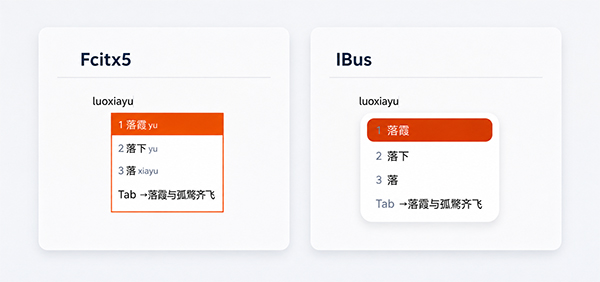

# Cassotis IME for Linux

<p align="center">
  
</p>

<p align="center">
  <a href="https://www.yanquan.org">
    <picture>
      <source media="(prefers-color-scheme: dark)" srcset="readme_slogan_dark.svg">
      
    </picture>
  </a>
</p>

<p align="center">
  <a href="https://www.yanquan.org"></a>
  <a href="https://github.com/shenmin/cassotis-ime-linux/releases/latest"></a>
  <a href="LICENSE"></a>
  <a href="https://github.com/shenmin/cassotis-ime-linux/actions/workflows/ci.yml"></a>
</p>

<p align="center">
  
</p>

**[Website: www.yanquan.org](https://www.yanquan.org)** | English | [简体中文](README.CN.md) | [Windows version](https://github.com/shenmin/cassotis-ime) | [macOS version](https://github.com/shenmin/cassotis-ime-mac)

Cassotis IME for Linux (言泉输入法 Linux 版) is an experimental Chinese Pinyin input method for Linux desktops. Native IBus and Fcitx 5 adapters connect to a shared Free Pascal engine service ported from [Cassotis IME for Windows](https://github.com/shenmin/cassotis-ime), paired with dictionaries built from [Cassotis Lexicon](https://github.com/shenmin/cassotis-lexicon). Candidate ranking runs locally on the CPU using an in-house character-level language model. There are no ads, bundled programs, or telemetry: dictionaries, settings, and user learning data remain on the local machine.

Version 2.7.0 aligns with Cassotis IME for Windows and Cassotis Lexicon v2.7.0. Release highlights are summarized in the [version history](#version-history) below, full change notes are in the [changelog](CHANGELOG.md), and prebuilt packages are published under [Releases](https://github.com/shenmin/cassotis-ime-linux/releases).

Current goals:
- Track each Windows engine release and verify cross-platform parity on shared benchmarks.
- Provide native IBus and Fcitx 5 integration on GNOME, KDE, and other Linux desktops.
- Ship offline `amd64` and `arm64` packages that require neither network access nor a GPU.

## Name Origin
**Cassotis** is named after the sacred spring at the Temple of Delphi. In Greek tradition, the priestess Pythia drank from this spring before delivering oracles—making it a symbol of spoken prophecy and inspiration, and a nod to the path from Delphi to natural language.

The Chinese name **言泉** (*Yanquan*, "Spring of Words") echoes the imagery of Cassotis and draws on the idiom **言如泉涌** ("words flowing like a spring"), expressing the goal of a fluent, natural typing experience.

## Features
- **IBus and Fcitx 5.** Both adapters connect to a single shared engine service and use the same settings, dictionaries, and learned vocabulary. Only one framework should be active per desktop session.
- **Candidate panel.** Candidates are rendered natively by IBus or Fcitx 5 using the active desktop theme; each page displays 3 to 9 candidates (9 by default) and supports paging via `-/+`, `[/]`, `,/.`, or `Shift+Tab/Tab`. Appearance settings offer automatic, fixed vertical, or fixed horizontal layout; see [Candidate Layout](CONFIGURATION.md#candidates).
- **English recognition.** In Chinese full-Pinyin half-width mode, known English words and proper nouns (`pro`, `markdown`, `Effie`), mixed-case inputs, and previously committed raw letter strings appear as an unnumbered candidate ahead of numbered Chinese candidates. When the input has no full-word Chinese reading, the English candidate is selected by default so `Space` commits it directly; when a Chinese reading exists (`bug`, `mac`), the language model scores the English token against Chinese candidates in context. Numbered Chinese shortcuts remain unchanged, and raw English commits are not recorded in the Chinese user dictionary. Enabled by default and configurable in Settings; Double Pinyin retains standard Chinese decoding.
- **One-key completion.** Displays at most one high-confidence continuation separately from the candidate list, accepted with `Tab` or backtick (whichever is configured). Dictionary prefix matches and strong bigram transitions appear immediately, while the language model reranks or extends completions asynchronously in the background and suppresses low-confidence hints.
- **Poetry completion.** Typing the opening of an indexed classical verse completes the full line; finishing an entire line can suggest the next line of the poem with punctuation.
- **Long sentences.** Lexicon-constrained path search constructs full-sentence candidates (for example `womenjintian` → `我们今天`) while keeping prefix words and single characters selectable for step-by-step commitment. The language model ranks full-sentence candidates and applies context-aware homophone repair against the typed Pinyin and preceding text.
- **Short words.** Competing exact-match candidates are ranked using language-model scores and general-corpus word frequencies, incorporating committed text before the cursor when available. Without context, general and conversational word-frequency signals prevent rare words from displacing common defaults solely on language-model score. With preceding context, single-syllable character candidates are also ordered by the language model.
- **Traditional input.** Candidates and committed text use Taiwan traditional character forms. Internally, language-model scoring and background completion evaluate simplified equivalents so traditional character forms are not penalized during ranking.
- **Short phrases.** Three- to five-syllable inputs absent from the dictionary (for example `jiuguize` → `旧规则`) are assembled from base dictionary words, ranked as complete clauses by the language model using preceding context, and checked for homophone errors. Non-top phrase selections are recorded in the user dictionary.
- **Pinyin schemes.** Full Pinyin, initial-letter abbreviations (`jt` → `今天`), and seven Double Pinyin layouts (Microsoft, Xiaohe, Ziranma, Sogou, Ziguang, Pinyin Jiajia, and Zhineng ABC) share candidate ranking and user learning data. Eleven fuzzy-Pinyin pairs can be toggled individually. `lue`/`nue` are accepted for `lve`/`nve` and `jv`/`qv`/`xv` for `ju`/`qu`/`xu`; an apostrophe separates syllables unless the optional second/third selection keys are enabled.
- **Second/third selection keys.** Optional `;` and `'` shortcuts select the second and third visible candidates (disabled by default). In Double Pinyin layouts that use `;` as a final key, syllable input takes precedence. See [Selection Keys](CONFIGURATION.md#secondthird-selection-keys).
- **Dictionaries and learning.** Simplified and traditional base dictionaries are kept separate from the user dictionary. Learned entries adapt to the active simplified or traditional mode via OpenCC; highlight a learned candidate and press `Ctrl+Delete` to delete it.
- **Document-local adaptation.** Surrounding text exposed by the input framework temporarily boosts terms and continuations recurring in the active document. Context state stays in memory, is isolated per input context, and is never written to disk.
- **Personal word frequencies.** Advanced settings can import personal word-frequency exports in CSV, TSV, or plain-text format, applying the same validation rules as normal candidate learning across both frameworks. See [Importing Word Frequencies](CONFIGURATION.md#importing-word-frequencies) for supported formats and precautions.
- **Quick input.** Supports `ufh` symbols, `uxh` numbered markers, `usx` mathematical symbols, `ujt` arrows, `udw` units, `ubd` Chinese punctuation, and `urq`/`usj`/`uxq` for the current date, time, and weekday; `i123.45` and `v123.45` format Chinese numerals and uppercase currency amounts. Double Pinyin enters these modes with `Shift+U/I/V`. See [Quick Input](CONFIGURATION.md#quick-input).
- **Chinese punctuation.** In Chinese punctuation with half-width input, a period typed immediately after digits outputs a decimal point, and symbols kept half-width can be customized in Settings; the default Markdown preset keeps ``-#*+_=`~[]<>|@`` half-width while commas, periods, parentheses, and quotation marks stay Chinese.
- **Settings.** Native GTK 3 settings application covering all Linux options; each function shortcut can be disabled individually without losing its key binding.
- **Custom phrases.** Map letter shortcuts to fixed phrases, addresses, or multiline text. Exact shortcut matches appear in the completion row and commit literally via the configured `Tab` or backtick key without altering numbered candidates or user-dictionary learning. Settings supports custom ordering and JSON import/export, with diagnostics under Advanced. See [Custom Phrases](CONFIGURATION.md#custom-phrases).
- **Offline CPU inference.** Runs completely offline without a GPU. Dictionary candidates are available from the first keystroke; while the language model is loading in the background or if model files are absent, candidates continue to be served using dictionary ranking.

## Download and Install

Download packages and checksums from [GitHub Releases](https://github.com/shenmin/cassotis-ime-linux/releases). Every package includes both the IBus and Fcitx 5 adapters, the base dictionaries, and the language model. Select the installation method matching your system:

| System | Download | Installation method |
| --- | --- | --- |
| Debian, Ubuntu, and derivatives with compatible dependencies | `.deb` | [APT installation](#debian-installation) |
| SteamOS Desktop Mode and other systems with read-only system directories | `.tar.gz` | [User installation (without sudo)](#user-installation) |
| Other distributions with compatible libraries and writable system directories | `.tar.gz` | [System-wide portable installation](#system-installation) |

Portable archives ship the same dynamically linked binaries as the matching `.deb` packages and require compatible system runtime libraries; they are not static distribution-independent builds. Run the portable installer's dependency preflight check first, and build from source if the prebuilt binaries are incompatible. User dictionaries and settings are preserved across all upgrade and uninstall methods.

<a id="debian-installation"></a>

### Debian / Ubuntu: APT Installation

Download the `.deb` matching your system architecture, verify its SHA-256 checksum against the digest listed in the release assets, and install via APT:

```bash
arch="$(dpkg --print-architecture)"  # amd64 or arm64
package="cassotis-ime_2.7.0_${arch}.deb"
sha256sum "${package}"
sudo apt install "./${package}"
```

The installer refreshes active IBus and Fcitx 5 desktop sessions. On GNOME with IBus, Cassotis is added to the input-source list without rebooting or signing out, and your active input source is left unchanged. If no graphical session is running during installation, Cassotis is picked up at the next login. Press `Super+Space` and select **Cassotis 言泉拼音输入法** to begin typing.

In an Fcitx 5 session, set Fcitx 5 as the desktop input-method framework first, then add Cassotis through `fcitx5-configtool`. Both IBus and Fcitx 5 packages may be installed on the system, but only one framework should manage a given desktop session.

Open settings from the Cassotis preferences entry in GNOME input sources or from `fcitx5-configtool`; you can also run `/usr/libexec/cassotis-ime/cassotis-settings` directly. Upgrade by installing a newer `.deb` the same way, and uninstall with `sudo apt remove cassotis-ime`.

Upgrades reload the active input framework. If an already-open application stops responding to Chinese input after an upgrade, save your work and restart that application to reconnect.

<a id="user-installation"></a>

### SteamOS and Other Read-Only Systems: User Installation

Download the portable archive matching `uname -m` (`x86_64` or `aarch64`) and verify its SHA-256 checksum. In SteamOS **Desktop Mode** or other desktops with read-only system directories, install into your user home directory. Do not reuse an older install script or run `sudo ./install.sh`. Finish any active Pinyin composition, then run the following commands as your regular desktop user **without `sudo` or `su`**:

```bash
arch="$(uname -m)"  # x86_64 or aarch64
archive="cassotis-ime-linux-2.7.0-${arch}.tar.gz"
sha256sum "${archive}"
tar -xzf "${archive}"
cd "cassotis-ime-linux-2.7.0-${arch}"
./install.sh --user --check &&
./install.sh --user
```

`--check` runs preflight checks without writing files, and installation proceeds only if all checks pass. By default, KDE prefers an installed Fcitx 5 setup and GNOME prefers IBus; pass `--framework fcitx5` or `--framework ibus` to override (use the same flag on both commands). The installer verifies CPU architecture, shared-library/ABI compatibility, and framework version before copying files: binaries go under `~/.local/libexec/cassotis-ime` and dictionaries under `${XDG_DATA_HOME:-$HOME/.local/share}/cassotis-ime`, without touching `/usr` or disabling read-only filesystem protection. The target input framework must already be installed and active in your desktop session; the installer neither installs system packages nor switches frameworks.

After installation, enable Cassotis in your active framework; if the input method list has not refreshed, restart the framework or sign out and back in. The settings binary is located at `~/.local/libexec/cassotis-ime/cassotis-settings`.

The portable archive bundles an isolated OpenCC runtime and data fallback used only when host OpenCC libraries are absent, never overwriting system libraries. User-directory installation, upgrade, removal, and typing have been verified on SteamOS 3.8.14 (KDE X11, IBus 1.5.32); SteamOS Gaming Mode and Fcitx 5 on SteamOS are not yet covered. If preflight checks report incompatible libraries or an older Fcitx release, build from source for that distribution rather than disabling read-only system protection. See [user installation and removal](BUILD.md#portable-user-installation).

To upgrade, extract the newer archive and rerun the preflight and installation commands as the same desktop user. To uninstall, run `./uninstall.sh --user` **without `sudo`**; only tracked, unmodified package files are removed. Do not mix system-wide, source-user, and portable-user installations on the same account.

<a id="system-installation"></a>

### Other Systems: System-Wide Portable Installation

Use this method only on distributions with writable system directories, root privileges, and compatible runtime libraries. On SteamOS and other read-only systems, use [user installation](#user-installation) above.

**Do not run system-wide installation from v2.1.0 or earlier portable archives.** Older install scripts could overwrite ownership, permissions, and SELinux contexts on existing system directories, breaking desktop login. Use a v2.5.0 or newer portable archive, or install with `--user` instead. Fixed archives include `install-support/system_install.py`, which preserves existing directory attributes and requires `restorecon` (typically from `policycoreutils`) when SELinux is enabled.

From an extracted v2.5.0+ portable archive directory:

```bash
if test -r install-support/system_install.py; then
    sudo ./install.sh --system
else
    printf 'Use a fixed portable installer or --user installation.\n' >&2
fi
```

The portable installer does not install system library dependencies; required runtime libraries are listed in [BUILD.md](BUILD.md). Uninstall with `sudo ./uninstall.sh`.

The updated installer prevents directory attribute corruption during new writes, but cannot automatically reconstruct system directory attributes altered by an older script. If desktop login is already affected, restore directory permissions and SELinux contexts using your distribution's recovery tools before reinstalling; do not disable SELinux or apply recursive permission changes as a workaround.

## Architecture
- `src/engine`: Pinyin parsing, candidate generation, ranking, and user learning, ported from the Windows engine.
- `src/host`: language-model inference, homophone repair, and background completion scheduling; `src/host/native` contains the C++20 ONNX Runtime bridge and custom attention operator.
- `src/service`: shared background engine daemon (`cassotis-engine`) serving both frameworks over a Unix domain socket, including idle heap trimming.
- `src/ipc`: IPC protocol between framework adapters and `cassotis-engine`.
- `src/dictionary`, `src/common`: SQLite dictionary access, user dictionary storage, configuration, and platform utilities.
- `adapters/ibus`, `adapters/fcitx5`, `adapters/common`: IBus and Fcitx 5 adapters and the GTK 3 settings application.
- `data`: dictionary SQLite schema and split language-model archives (`data/models/char_lm`).
- `third_party/onnxruntime`: prebuilt CPU ONNX Runtime 1.20.1 libraries for `x86_64` and `aarch64`.
- `scripts`, `packaging`: build, installation, and release packaging scripts.
- `tools/control`: engine service control CLI.

## Runtime Files
- `cassotis-engine`: shared background engine service that loads dictionaries and the language model.
- `ibus-engine-cassotis`: IBus engine executable.
- `libcassotis.so`: Fcitx 5 addon shared library.
- `cassotis-settings`, `cassotis-control`: GTK 3 settings app and service control client.
- `libcassotis_pinyin_transformer_ort.so`, `libonnxruntime.so.1.20.1`, and `char_lm/`: native inference bridge, ONNX Runtime library, and model directory, loaded exclusively by `cassotis-engine` (never by the frontend adapters).
- `dict_sc.db`, `dict_tc.db`: simplified and traditional base dictionaries under `/usr/share/cassotis-ime/` (system installs) or `~/.local/share/cassotis-ime/` (user installs).

Input conversion requires `cassotis-engine` to be running. If model files are missing, conversion still works using dictionary-only ranking.

## Build (Quick Start)
Build prerequisites: Linux `x86_64` or `aarch64`, Free Pascal 3.2.2, C/C++20 compilers, SQLite 3, OpenCC, Python 3 with PyGObject and GTK 3, plus IBus and Fcitx 5 development headers. CMake, CUDA, a GPU, and a system-wide ONNX Runtime installation are not required.

```bash
./scripts/check_environment.sh
./rebuild_all.sh
```

`rebuild_all.sh` compiles the engine service, both framework adapters, the control client, and the native inference bridge into `build/bin/`, verifies SHA-256 checksums, and reassembles the numbered parts in `data/models/char_lm` into `char_lm.onnx`. To install a source build for the current desktop user, obtain matching `dict_sc.db` and `dict_tc.db` databases from [Cassotis Lexicon](https://github.com/shenmin/cassotis-lexicon) and run without `sudo`:

```bash
./scripts/install_ibus.sh --dictionary /path/to/dict_sc.db \
  --dictionary-traditional /path/to/dict_tc.db
# or
./scripts/install_fcitx5.sh --dictionary /path/to/dict_sc.db \
  --dictionary-traditional /path/to/dict_tc.db
```

Do not layer a source install on top of an installed `.deb` package. Full script flags and release packaging instructions are in [BUILD.md](BUILD.md).

## Dictionary Workflow
Base dictionaries are schema-24 SQLite databases built from [Cassotis Lexicon](https://github.com/shenmin/cassotis-lexicon) generated artifacts:
- base word lists: `dict_unihan_sc.txt`, `dict_unihan_tc.txt`, `dict_clean_sc.txt`, `dict_clean_tc.txt`
- corpus-derived statistical tables: word-transition priors, completion priors, general-corpus word frequencies, conversational word frequencies, and the precomputed short-word promotion table

The v2.7.0 dictionaries contain 264,167 simplified and 267,265 traditional reading records (including 23,919 and 24,182 single-character records; polyphonic entries store one record per reading). General word-frequency tables cover 201,868 simplified and 204,020 traditional surface forms, and conversational frequency tables cover 106,115 and 107,002 forms. Both dictionaries include curated classical poetry verses and audited polyphonic readings, with Taiwan traditional character standards applied consistently across traditional word lists and ranking tables. User learning data is stored in `~/.local/share/cassotis-ime/user_dict.db`; at startup, the engine prefers base dictionaries paired with the running installation over leftover copies from other install paths. Database schema details and path-override environment variables are documented in [docs/DICTIONARY.md](docs/DICTIONARY.md).

## Models and Ranking

### Unified Character Language Model
- **Architecture and scope.** A single in-house ~150M-parameter character-level autoregressive language model (11 layers, 1,024 hidden size, 12,017-character vocabulary, static INT8 quantization) handles neural scoring across the input pipeline: long-sentence reranking and Pinyin-conditioned homophone repair, short-word and contextual single-character disambiguation, out-of-dictionary short-phrase assembly, English-vs-Pinyin disambiguation, background one-key completion reranking, and long-sentence `Tab` continuation. Model weights match Cassotis IME for Windows; obsolete model files from earlier releases are removed automatically on upgrade.
- **Training data.** Trained on independent Chinese general-text and fiction corpora for both standard autoregressive scoring and Pinyin-conditioned repair. Starting in v2.7.0, training continued on the 10% subset of the public LCCC dialogue corpus closest to everyday chat, then weight-averaged 50/50 with the prior checkpoint to improve conversational phrasing without regressing fiction and general prose. All benchmark test sets are strictly excluded from training data.
- **Batch-invariant deterministic inference.** Fixed static quantization ranges paired with a custom attention operator ensure that any text sequence produces bit-identical scores regardless of batch layout or prior cache state. Typing a long sentence key by key yields the exact same candidates as decoding the complete Pinyin string at once.
- **Memory footprint.** In v2.0.0 tests, resident memory (RSS) of `cassotis-engine` settled at ~311 MiB on `x86_64` and ~320 MiB on `aarch64` after model load and 5 seconds of idle time, compared with ~437 MiB in v1.0.0 (which carried the separate neural models of Windows v1.31.0). These figures are historical post-idle RSS measurements rather than benchmark peak RSS.

### Decision Models and Lexicon Signals
- Six lightweight gradient-boosted decision tree (GBDT) models combine language-model scores with lexical statistics for final selection: long-sentence selection, context-free short-word selection, contextual short-word selection, context-detail scoring, one-key completion, and `Tab` continuation. All six models are compiled directly into the engine with the exact Windows parameters, adding no extra ONNX files or inference sessions.
- Three compact structural rankers guide lattice pruning during long-sentence search and pre-rank the complete-sentence candidate pool.
- Corpus-derived SQLite tables provide lexical priors alongside neural scores: word transitions, completion priors, a precomputed short-word promotion table, and word frequencies from both general prose and everyday conversation.

### Ranking by Input Path
- **Long sentences.** Lexicon-constrained lattice search builds full-sentence candidates, using two structural rankers for beam pruning and a third to order the candidate pool. The language model scores the top candidates, and the long-sentence GBDT selects the first and second choices. A Pinyin-conditioned repair pass then checks the top sentence against the typed syllables and up to 48 characters of preceding context to fix residual homophone errors (with a bounded second pass when needed). Active across simplified/traditional modes and Full/Double Pinyin; user dictionary entries and exact full-query dictionary words are never rewritten.
- **Short words.** The dictionary's precomputed promotion table sets the baseline order, after which the short-word GBDTs combine language-model scores with general-corpus word frequencies, consulting committed preceding text when the context-free margin is inconclusive. Without context, candidates at least 10x rarer in general text cannot override the baseline first choice on language-model score alone, and strong conversational frequency can likewise retain a common default supported by general frequency and dictionary weight. Single-character candidates also incorporate preceding context. Personal user learning remains separate from base-dictionary statistics.
- **Out-of-dictionary phrases.** Three- to five-syllable inputs absent from both the base and user dictionaries are segmented into candidate multi-word drafts, scored by the language model for standalone clause fluency, and passed through Pinyin-conditioned homophone repair. Active in Double Pinyin and traditional mode as well; fuzzy Pinyin and explicit `'` syllable separators use their standard segmented candidate paths.
- **English vs. Chinese readings.** When typed letters also match a valid Chinese word reading, a single contextual language-model call compares the raw letter string against the leading full-word Chinese candidates on the first page, placing the English token first only when it holds a clear margin.
- **One-key completion.** Dictionary prefix and strong-transition completions appear immediately; an asynchronous background pass reranks a broader set of dictionary words with the language model and replaces the displayed hint only when confidence improves clearly.
- **Long-sentence `Tab` continuation.** The language model predicts upcoming characters and evaluates candidate word completions and next-phrase continuations; the `Tab` continuation GBDT selects one continuation or suppresses low-confidence hints.

### Runtime Behavior
- All inference runs locally on the CPU via the bundled ONNX Runtime, with no network requests or GPU dependency.
- Only `cassotis-engine` loads the language model on a background thread; regular candidate lookup, selection, text commit, and static completion never block on model initialization.
- Foreground language-model calls carry a 100 ms timeout and background completions carry a 120 ms timeout; timed-out evaluations are dropped and existing candidates remain unchanged.
- Inference uses one thread per available CPU core, capped at 6 threads on `x86_64` and 8 threads on `aarch64`.
- After 5 seconds without input, the engine service returns unused heap pages to the OS while keeping model weights and context caches resident.

## Benchmarks

The `v2.7.0` rows report native measurements of the current engine and dictionaries, while earlier rows retain their original release measurements; see [Compatibility](COMPATIBILITY.md) for the scope of framework and packaging checks. Since v2.0.0, corpus benchmarks run with wall-clock search, language-model, and completion timeouts disabled: accuracy and latency are recorded from the same completed query using 8 model threads, while deterministic search budgets remain unchanged.
Test methodology, corpus provenance, and scoring rules are detailed in [BENCHMARK.md](BENCHMARK.md) ([Chinese](BENCHMARK.CN.md)). Benchmark cases match Cassotis IME for Windows, sampled from the developer's novel [**Elegance in Timelessness** (永恒的舞动)](https://www.qidian.com/book/1037259117/) and strictly excluded from all training data.

The v2.7.0 figures were measured on 2026-11-11 (UTC+8) on 8-vCPU Ubuntu 26.04.1 VMs: `x86_64` with 16 GiB RAM on an Intel Core i5-12600K host, and `aarch64` with 8 GiB RAM on Apple silicon. Versions 2.6.0, 2.5.0, 2.1.0, and 2.0.0 were measured on 2026-11-03, 2026-10-29, 2026-10-25, and 2026-10-17 on the same hosts, though not as hardware-controlled A/B runs. Versions 2.1.0 through 2.7.0 share the same audited test set (including 11,685 contested short-word cases); earlier releases used the pre-audit 11,728-case contested subset and are not paired case-for-case comparisons. All latencies are in milliseconds (`ms`).

Installed builds retain the production 100 ms foreground and 120 ms background timeouts. Deadline-free benchmark scores do not imply identical output under production timeouts (for instance, an earlier timed `x86_64` long-sentence run recorded 37 fewer Top1 and 36 fewer Top2 hits). Complete breakdowns, timing definitions, and historical timed runs are documented in [BENCHMARK.md](BENCHMARK.md).

### Long Sentence Benchmark-16300

| Version | Architecture | Top1 | Top2 | Mean (ms) | P50 (ms) | P95 (ms) | Max (ms) |
|---|---|---:|---:|---:|---:|---:|---:|
| `v2.7.0` | x86_64 | 13739/16300 (84.29%) | 14685/16300 (90.09%) | 167.765 | 161 | 287 | 671 |
| `v2.7.0` | aarch64 | 13733/16300 (84.25%) | 14682/16300 (90.07%) | 127.789 | 119 | 228 | 621 |
| `v2.6.0` | x86_64 | 13740/16300 (84.29%) | 14686/16300 (90.10%) | 163.435 | 160 | 264 | 619 |
| `v2.6.0` | aarch64 | 13736/16300 (84.27%) | 14684/16300 (90.09%) | 124.143 | 118 | 209 | 557 |
| `v2.5.0` | x86_64 | 13442/16300 (82.47%) | 14358/16300 (88.09%) | 142.697 | 143 | 214 | 534 |
| `v2.5.0` | aarch64 | 13434/16300 (82.42%) | 14351/16300 (88.04%) | 112.076 | 110 | 178 | 496 |
| `v2.1.0` | x86_64 | 13435/16300 (82.42%) | 14314/16300 (87.82%) | 150.925 | 151 | 227 | 536 |
| `v2.1.0` | aarch64 | 13435/16300 (82.42%) | 14313/16300 (87.81%) | 117.718 | 115 | 189 | 581 |
| `v2.0.0` | x86_64 | 13397/16300 (82.19%) | 14281/16300 (87.61%) | 147.95 | 148 | 223 | 1061 |
| `v2.0.0` | aarch64 | 13399/16300 (82.20%) | 14282/16300 (87.62%) | 115.22 | 112 | 185 | 536 |
| `v1.0.1`<br/>`v1.0.0` | x86_64 | 12940/16300 (79.39%) | 13534/16300 (83.03%) | 114.70 | 114 | 178 | 486 |
| `v1.0.1`<br/>`v1.0.0` | aarch64 | 12946/16300 (79.42%) | 13537/16300 (83.05%) | 98.10 | 97 | 159 | 472 |
| `v0.9.1` | x86_64 | 11998/16300 (73.61%) | 12970/16300 (79.57%) | 173.66 | — | 320 | 912 |
| `v0.9.1` | aarch64 | 11992/16300 (73.57%) | 12969/16300 (79.56%) | 64.52 | — | 118 | 416 |
| `v0.9.0` | x86_64 | 11998/16300 (73.61%) | 12970/16300 (79.57%) | 160.92 | 177 | 292 | 808 |
| `v0.9.0` | aarch64 | 11992/16300 (73.57%) | 12969/16300 (79.56%) | 62.13 | 60 | 118 | 414 |
| `v0.8.0` | x86_64 | 11979/16300 (73.49%) | 12954/16300 (79.47%) | 195.31 | 206 | 347 | 1224 |
| `v0.8.0` | aarch64 | 11975/16300 (73.47%) | 12954/16300 (79.47%) | 80.64 | 75 | 146 | 586 |

From v2.0.0 onward, accuracy and latency come from the same deadline-free run; v1.0.0/v1.0.1 come from a single production-mode run (100 ms model timeout); v0.9.1 and earlier take accuracy from a separate deterministic run and latency from a production-mode run. Because timing policies differ across eras, rows are not controlled speed comparisons. v1.0.1 changed only adapter punctuation handling and shares the engine, models, and dictionaries of v1.0.0. Reported latency measures full-sentence decoding in one pass rather than per-keystroke UI latency. Results prior to v0.8.0 are in [BENCHMARK.md](BENCHMARK.md).

### Short-word Context Benchmark-65000

| Version | Architecture | Top1 | Top2 | Contested Top1 | Contested Top2 | Mean (ms) | P50 (ms) | P95 (ms) | Max (ms) |
|---|---|---:|---:|---:|---:|---:|---:|---:|---:|
| `v2.7.0` | x86_64 | 63502/65000 (97.70%) | 64564/65000 (99.33%) | 10545/11685 (90.24%) | 11315/11685 (96.83%) | 8.830 | 5 | 24 | 77 |
| `v2.7.0` | aarch64 | 63503/65000 (97.70%) | 64560/65000 (99.32%) | 10545/11685 (90.24%) | 11314/11685 (96.82%) | 7.871 | 5 | 21 | 55 |
| `v2.6.0` | x86_64 | 63454/65000 (97.62%) | 64518/65000 (99.26%) | 10514/11685 (89.98%) | 11280/11685 (96.53%) | 8.426 | 5 | 24 | 272 |
| `v2.6.0` | aarch64 | 63454/65000 (97.62%) | 64520/65000 (99.26%) | 10516/11685 (90.00%) | 11282/11685 (96.55%) | 7.898 | 5 | 21 | 58 |
| `v2.5.0` | x86_64 | 63463/65000 (97.64%) | 64436/65000 (99.13%) | 10512/11685 (89.96%) | 11223/11685 (96.05%) | 8.825 | 5 | 25 | 74 |
| `v2.5.0` | aarch64 | 63465/65000 (97.64%) | 64438/65000 (99.14%) | 10514/11685 (89.98%) | 11225/11685 (96.06%) | 7.566 | 5 | 20 | 56 |
| `v2.1.0` | x86_64 | 63455/65000 (97.62%) | 64423/65000 (99.11%) | 10539/11685 (90.19%) | 11225/11685 (96.06%) | 8.491 | 5 | 24 | 79 |
| `v2.1.0` | aarch64 | 63454/65000 (97.62%) | 64423/65000 (99.11%) | 10538/11685 (90.18%) | 11225/11685 (96.06%) | 7.988 | 5 | 22 | 68 |
| `v2.0.0` | x86_64 | 63364/65000 (97.48%) | 64292/65000 (98.91%) | 10533/11728 (89.81%) | 11244/11728 (95.87%) | 8.637 | 5 | 25 | 113 |
| `v2.0.0` | aarch64 | 63361/65000 (97.48%) | 64291/65000 (98.91%) | 10532/11728 (89.80%) | 11244/11728 (95.87%) | 7.909 | 5 | 21 | 84 |
| `v1.0.1`<br/>`v1.0.0` | x86_64 | 63036/65000 (96.98%) | 64104/65000 (98.62%) | 10491/11728 (89.45%) | 11196/11728 (95.46%) | 8.286 | 8 | 20 | 42 |
| `v1.0.1`<br/>`v1.0.0` | aarch64 | 63038/65000 (96.98%) | 64104/65000 (98.62%) | 10489/11728 (89.44%) | 11197/11728 (95.47%) | 6.638 | 6 | 16 | 31 |
| `v0.9.1` | x86_64 | 61971/65000 (95.34%) | 63568/65000 (97.80%) | 9675/11728 (82.49%) | 10776/11728 (91.88%) | 13.568 | — | 38 | 91 |
| `v0.9.1` | aarch64 | 61975/65000 (95.35%) | 63568/65000 (97.80%) | 9677/11728 (82.51%) | 10776/11728 (91.88%) | 5.405 | — | 14 | 29 |
| `v0.9.0` | x86_64 | 61971/65000 (95.34%) | 63568/65000 (97.80%) | 9675/11728 (82.49%) | 10776/11728 (91.88%) | 12.791 | 8 | 36 | 88 |
| `v0.9.0` | aarch64 | 61975/65000 (95.35%) | 63568/65000 (97.80%) | 9677/11728 (82.51%) | 10776/11728 (91.88%) | 5.281 | 4 | 14 | 31 |
| `v0.8.0` | x86_64 | 61860/65000 (95.17%) | 63549/65000 (97.77%) | 9596/11728 (81.82%) | 10775/11728 (91.87%) | 11.819 | 9 | 29 | 73 |
| `v0.8.0` | aarch64 | 61860/65000 (95.17%) | 63549/65000 (97.77%) | 9596/11728 (81.82%) | 10775/11728 (91.87%) | 6.552 | 5 | 16 | 36 |

The table above reports runs with preceding context; `Contested` denotes queries whose Pinyin maps to at least two distinct target words in the test corpus. Without preceding context, v2.7.0 scores 61315/63820 on both architectures (Top1 is lower by 46 and 45 cases versus v2.6.0, while Top2 increases by 57 on each); with context, Top1 increases by 48 and 49 cases and Top2 increases by 46 and 40. Full breakdowns and tradeoffs are recorded in [BENCHMARK.md](BENCHMARK.md#candidate-selection).

### One-key Completion Context Benchmark-12831

| Version | Architecture | Completion hits | Average saved keys | Keystroke stability | Key P95 (ms) | Settled P95 (ms) |
| --- | --- | --- | --- | --- | --- | --- |
| `v2.7.0` | x86_64 | 10506/12831 (81.88%) | 2.635 | 2141/2202 (97.23%) | 2.066 | 53.422 |
| `v2.7.0` | aarch64 | 10505/12831 (81.87%) | 2.634 | 2139/2200 (97.23%) | 2.035 | 36.182 |
| `v2.6.0` | x86_64 | 10512/12831 (81.93%) | 2.635 | 2151/2214 (97.15%) | 2.043 | 55.296 |
| `v2.6.0` | aarch64 | 10513/12831 (81.93%) | 2.635 | 2152/2215 (97.16%) | 2.034 | 36.199 |
| `v2.5.0` | x86_64 | 10512/12831 (81.93%) | 2.635 | 2151/2214 (97.15%) | 2.039 | 53.904 |
| `v2.5.0` | aarch64 | 10513/12831 (81.93%) | 2.635 | 2152/2215 (97.16%) | 2.021 | 37.477 |
| `v2.1.0` | x86_64 | 10512/12831 (81.93%) | 2.636 | 2152/2215 (97.16%) | 2.166 | 54.492 |
| `v2.1.0` | aarch64 | 10513/12831 (81.93%) | 2.636 | 2153/2216 (97.16%) | 2.100 | 37.961 |
| `v2.0.0` | x86_64 | 10456/12831 (81.49%) | 2.632 | 2131/2193 (97.17%) | 2.137 | 58.125 |
| `v2.0.0` | aarch64 | 10458/12831 (81.51%) | 2.632 | 2133/2195 (97.18%) | 2.137 | 59.205 |
| `v1.0.1`<br/>`v1.0.0` | x86_64 | 10336/12831 (80.55%) | 2.638 | 2123/2185 (97.16%) | 1.441 | 16.180 |
| `v1.0.1`<br/>`v1.0.0` | aarch64 | 10336/12831 (80.55%) | 2.638 | 2122/2185 (97.12%) | 1.306 | 12.302 |
| `v0.9.1`<br/>`v0.9.0` | x86_64 | 9420/12831 (73.42%) | 2.548 | 1691/1749 (96.68%) | 2 | 2 |
| `v0.9.1`<br/>`v0.9.0` | aarch64 | 9420/12831 (73.42%) | 2.548 | 1691/1749 (96.68%) | 1 | 1 |
| `v0.8.0` | x86_64 | 9420/12831 (73.42%) | 2.548 | 1691/1749 (96.68%) | 3 | 3 |
| `v0.8.0` | aarch64 | 9420/12831 (73.42%) | 2.548 | 1691/1749 (96.68%) | 2 | 2 |

The 65,000 short-word cases expand into 12,831 completion opportunities. Since v2.0.0, `Settled P95` records every completed background evaluation regardless of whether it replaces the displayed hint; during interactive typing, static hints appear immediately without waiting for background evaluation. In v1.0.0/v1.0.1, background time was counted only when the hint changed; prior to v1.0.0 there was no background reranking and both latencies were recorded in integer milliseconds.

### Long-sentence One-key Completion Benchmark-16300

| Version | Architecture | Local continuation hits | Predictive coverage | Total saved keys | P95 (ms) |
| --- | --- | --- | --- | --- | --- |
| `v2.7.0` | x86_64 | 3979/16300 (24.41%) | 16232/16300 (99.58%) | 9814 | 286 |
| `v2.7.0` | aarch64 | 3980/16300 (24.42%) | 16234/16300 (99.60%) | 9838 | 221 |
| `v2.6.0` | x86_64 | 3949/16300 (24.23%) | 16155/16300 (99.11%) | 9695 | 266 |
| `v2.6.0` | aarch64 | 3955/16300 (24.26%) | 16152/16300 (99.09%) | 9709 | 210 |
| `v2.5.0` | x86_64 | 3896/16300 (23.90%) | 16152/16300 (99.09%) | 9592 | 241 |
| `v2.5.0` | aarch64 | 3904/16300 (23.95%) | 16147/16300 (99.06%) | 9611 | 193 |
| `v2.1.0` | x86_64 | 3876/16300 (23.78%) | 16147/16300 (99.06%) | 9576 | 251 |
| `v2.1.0` | aarch64 | 3883/16300 (23.82%) | 16142/16300 (99.03%) | 9591 | 202 |
| `v2.0.0` | x86_64 | 3766/16300 (23.10%) | 16121/16300 (98.90%) | 9271 | 251 |
| `v2.0.0` | aarch64 | 3778/16300 (23.18%) | 16114/16300 (98.86%) | 9298 | 194 |
| `v1.0.1`<br/>`v1.0.0` | x86_64 | 3514/16300 (21.56%) | 15814/16300 (97.02%) | 7479 | 196 |
| `v1.0.1`<br/>`v1.0.0` | aarch64 | 3536/16300 (21.69%) | 15816/16300 (97.03%) | 7508 | 164 |
| `v0.9.1` | x86_64 | *421/16300 (2.58%)* | — | *977* | 277 |
| `v0.9.1` | aarch64 | *423/16300 (2.60%)* | — | *979* | 101 |
| `v0.9.0` | x86_64 | *423/16300 (2.60%)* | — | *979* | 244 |
| `v0.9.0` | aarch64 | *423/16300 (2.60%)* | — | *979* | 90 |
| `v0.8.0` | x86_64 | *425/16300 (2.61%)* | 6758/16300 (41.46%) | *987* | 286 |
| `v0.8.0` | aarch64 | *425/16300 (2.61%)* | 6770/16300 (41.53%) | *982* | 107 |

Each test case omits the final four complete syllables of a sentence and evaluates the single continuation shown in the panel; any continuation that accurately extends the typed prefix counts as a hit, without requiring full-sentence completion. Since v2.0.0, the benchmark waits for every background evaluation without a timeout, including evaluations that keep the existing hint. Earlier rows reflect the production background timeout of their release (120 ms from v1.0.0, 50 ms earlier); installed builds continue to enforce a 120 ms limit. Italicized figures through v0.9.1 use the older scoring rule that distinguishes `他` and `她`, and are not directly comparable with later rows. `Predictive coverage` counts prompts that predict unread syllables—excluding exact dictionary conversions of already-typed Pinyin—and is not a precision metric.

## Configuration
Settings are managed by the shared engine service so IBus and Fcitx 5 stay in sync. Launch **Cassotis IME Settings** from your desktop application menu or the input framework's Cassotis menu.

Key configuration options:
- Input mode (Simplified Chinese, Traditional Chinese, English) and Full/Double Pinyin layout
- Individual toggles for 11 fuzzy-Pinyin pairs
- Punctuation style and full-width / half-width character mode
- Automatic decimal point when `.` follows digits
- English recognition in Chinese mode (enabled by default)
- Half-width symbol passthrough set in Chinese punctuation mode (Markdown preset by default)
- Candidate panel orientation: automatic, fixed vertical, or fixed horizontal
- Optional `;` and `'` shortcuts for the second and third candidates (disabled by default)
- Page size, paging keys, completion trigger key, and individually toggleable function shortcuts

User files follow the XDG Base Directory specification: user dictionary at `~/.local/share/cassotis-ime/user_dict.db` and engine socket at `$XDG_RUNTIME_DIR/cassotis-ime/engine.sock`. See [CONFIGURATION.md](CONFIGURATION.md) for the complete reference.

## Documentation
- Simplified Chinese documentation: [README.CN.md](README.CN.md)
- Website: [www.yanquan.org](https://www.yanquan.org)
- Benchmark methodology and results: [BENCHMARK.md](BENCHMARK.md) / [简体中文](BENCHMARK.CN.md)
- Configuration reference: [CONFIGURATION.md](CONFIGURATION.md) / [简体中文](CONFIGURATION.CN.md)
- Build, installation scripts, and packaging: [BUILD.md](BUILD.md)
- Desktop and framework compatibility: [COMPATIBILITY.md](COMPATIBILITY.md)
- Release changelog: [CHANGELOG.md](CHANGELOG.md)
- Dictionary format: [docs/DICTIONARY.md](docs/DICTIONARY.md)
- IPC and process architecture: [docs/IPC.md](docs/IPC.md)

## Roadmap
- Track each Windows release across the engine, language model, and dictionaries, keeping source-parity checks and shared benchmarks passing
- Reduce keystroke-to-candidate latency, particularly for long-sentence decoding on `x86_64`
- Broaden compatibility testing across distributions, desktop environments, and applications, including Chromium/Electron apps, mixed-DPI setups, SteamOS Gaming Mode, and Fcitx 5 on SteamOS
- Expand binary compatibility and dependency preflight coverage for portable archives
- Maintain post-idle RSS and cold-start first-key responsiveness within release budgets

## Version History
Major milestones of the Linux port (corresponding Cassotis IME for Windows versions in parentheses). Full per-release change logs are in [CHANGELOG.md](CHANGELOG.md).

**v0.1.0 (Windows v1.17.0): Initial release.** Shared Free Pascal engine supporting short words, long sentences, completions, contextual ranking, and user learning; native IBus and Fcitx 5 adapters sharing settings and dictionaries; GTK 3 settings app; `amd64` and `arm64` Debian packages and portable archives.

**v0.2.0 – v0.9.1 (Windows v1.18.0 – v1.29.0): Neural ranking and repair pipeline.** Introduced 42 compact ranking units and a native C++20/ONNX Runtime bridge for the first Transformer reranker (v0.2.0), followed by Pinyin-conditioned candidate scoring (v0.3.0), lexicon-constrained generation and document-local adaptation (v0.4.0), INT8 Pinyin-constrained local sentence repair (v0.6.0), joint repair (v0.8.0), and INT8 early-exit contextual short-word disambiguation (v0.9.0). Added sudo-free user-directory installation for SteamOS and other read-only systems (v0.8.0), and reduced resident memory via compact caches, memory-mapped model weights, and 5-second idle heap trimming (v0.9.1).

**v1.0.0 (Windows v1.31.0): Shared character language model.** Replaced the RBT3 short-context models with a shared character-level language model across long-sentence ranking, contextual short words, and completions; added asynchronous background reranking for short completions and policy-driven long-sentence completion over dictionary tails, next-word recall, and predicted characters.

**v2.0.0 (Windows v2.2.0): Unified single-LM architecture.** Consolidated separate neural models into one character language model plus seven compact ranking and decision units, automatically removing retired model files on upgrade. Added three- to five-syllable out-of-dictionary phrase assembly and homophone repair, English recognition in Chinese mode, `U`/`I`/`V` quick input, and ordered custom phrases.

**v2.1.0 (Windows v2.4.0): Language-model scoring for Traditional Chinese.** Evaluated Traditional Chinese candidates and context through simplified character mappings inside the language model while preserving Taiwan traditional character forms across candidates, repairs, and background completions. Added personal word-frequency import from third-party input methods.

**v2.5.0 (Windows v2.5.0): General-corpus word frequencies and version alignment.** Retrained the short-word selection model with general-corpus word frequencies to improve context-free ranking of everyday vocabulary, switched word-transition priors to per-query loading, and added selectable automatic, vertical, and horizontal candidate layouts. Unified Linux version numbers with Windows starting in v2.5.0.

**v2.6.0 (Windows v2.6.0): Joint-score homophone repair and split short-word policies.** Combined Pinyin-conditioned and full-sentence language-model scores for long-sentence homophone repair with bounded dictionary-word substitutions, and separated context-free and contextual short-word selection into dedicated GBDT policies.

**v2.7.0 (Windows v2.7.0): Conversational fine-tuning and broader input coverage.** Continued language-model training on everyday dialogue data, refit all six GBDT decision policies, and incorporated conversational word frequencies to protect common context-free defaults. Extended out-of-dictionary phrase assembly and repair to Traditional Chinese and Double Pinyin, enabled contextual language-model ordering for single-character candidates, and added the Zhineng ABC Double Pinyin layout.

## License
Program source code is licensed under GPL-3.0-only. Bundled Cassotis Lexicon database artifacts are licensed under CC BY-SA 4.0. See [LICENSE](LICENSE) and [NOTICE.md](NOTICE.md), including [lexicon attribution](docs/LEXICON_ATTRIBUTION.md).
