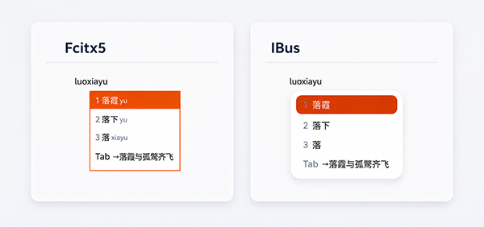

# Cassotis IME for Linux

<p align="center">
  
</p>

<p align="center">
  <a href="LICENSE"></a>
  <a href="https://github.com/shenmin/cassotis-ime-linux/actions/workflows/ci.yml"></a>
</p>

<p align="center">
  
</p>

English | [简体中文](README.CN.md) | [Windows version](https://github.com/shenmin/cassotis-ime) | [macOS version](https://github.com/shenmin/cassotis-ime-mac)

Cassotis IME for Linux (言泉输入法 Linux 版) is an experimental Chinese Pinyin input method for Linux desktops. Native IBus and Fcitx 5 adapters share one engine service written in Free Pascal, ported from [Cassotis IME for Windows](https://github.com/shenmin/cassotis-ime), with dictionaries generated by [Cassotis Lexicon](https://github.com/shenmin/cassotis-lexicon). Candidate ranking runs entirely on the local CPU, around a single character-level language model trained by the project.

Version 2.1.0 uses the engine and dictionaries of Cassotis IME and Cassotis Lexicon v2.4.0. It improves incremental word selection and short-phrase ranking, keeps strongly supported common words ahead when there is no context, and supports importing personal word frequencies. Traditional output is retained while the language model scores simplified equivalents. The existing single language model and seven compact ranking units are unchanged. Packages are available from [Releases](https://github.com/shenmin/cassotis-ime-linux/releases/tag/v2.1.0).

The project focus is:
- keep the Linux engine aligned with each Windows release and verify the alignment on the same benchmarks,
- integrate natively with IBus and Fcitx 5 on GNOME, KDE and other desktops,
- ship amd64 and arm64 packages that run without network access or a GPU.

## Name Origin
The English name **Cassotis** comes from the sacred spring inside the Temple of Delphi. Before delivering oracles, the priestess Pythia was said to drink from this spring to enter a prophetic state. The spring was regarded as the true source of prophecy and inspiration, where oracles were born, which resonates with the path from Delphi to human language.

The Chinese name **言泉** (Yanquan, "Spring of Words") matches Cassotis as a prophetic spring, while also carrying the meaning of **言如泉涌** ("words flowing like a spring"), reflecting our expectation of a fluent and intelligent input experience.

## Features
- **IBus and Fcitx 5.** Both adapters talk to one shared engine service, so they use the same settings, dictionaries and learned words. Only one framework needs to be active in a desktop session.
- **Candidate panel.** Candidates are drawn by IBus or Fcitx 5 and follow the desktop theme; the page holds 3 to 9 candidates (9 by default) and can be paged with `-/+`, `[/]`, `,/.` or `Shift+Tab/Tab`.
- **English recognition.** In Chinese full-Pinyin, half-width mode, letters that are an English word or name (`pro`, `markdown`, `Effie`), that are typed with a capital, or that were committed as letters before appear as an unnumbered candidate before the numbered ones. When the input has no Chinese reading as a whole they are highlighted and Space commits them as typed; when it has one (`bug`, `mac`), the language model weighs the letters against it with the preceding text. Chinese selection numbers stay unchanged, and raw text is never learned as a Chinese word. Enabled by default and optional in Settings; Double Pinyin keeps its normal behavior.
- **One-key completion.** Exactly one trusted continuation is shown, separately from the candidates, and accepted with `Tab` or the backtick key, whichever is configured. Dictionary and strong-transition completions appear at once; the language model reranks or extends them in the background and shows nothing when its confidence is insufficient.
- **Poetry completion.** Type the beginning of a stored line to complete it; a full line can offer the next line of the poem, including its punctuation, instead of a generic generated suffix.
- **Long sentences.** Lexicon-constrained path search builds complete candidates (for example `womenjintian` → `我们今天`) while keeping prefix words and single characters selectable for partial commitment. The language model chooses among the complete candidates and then corrects small homophone errors against the typed Pinyin and the text before the input.
- **Short words.** The language model resolves competing exact candidates, using the text already committed before the cursor when there is any.
- **Traditional input.** Candidates and committed text use Taiwan traditional forms. The language model reads simplified equivalents of candidates and preceding text, including in background completion, so traditional-only characters are not penalized merely for their written form.
- **Short phrases.** An input of three to five syllables that the dictionary does not contain (for example `jiuguize` → `旧规则`) gets whole phrases put together from dictionary words. The language model picks one, with the preceding text when there is any, and corrects its homophones against the typed Pinyin; a phrase picked from behind the first one is learned.
- **Pinyin schemes.** Full Pinyin, initial-letter abbreviations (`jt` → `今天`) and six Double Pinyin schemes (Microsoft, Xiaohe, Ziranma, Sogou, Ziguang and Pinyin Jiajia) share ranking and learning data. Eleven fuzzy-Pinyin pairs can be enabled individually. `lue`/`nue` are accepted for `lve`/`nve` and `jv`/`qv`/`xv` for `ju`/`qu`/`xu`; an explicit apostrophe always separates syllables.
- **Dictionaries and learning.** Separate simplified and traditional base dictionaries and one user dictionary. Learned words follow the selected simplified or traditional display through OpenCC; select a learned candidate and press `Ctrl+Delete` to remove it.
- **Document-local adaptation.** Text that the framework exposes around the cursor makes recurring terms and continuations easier to reach. It stays in memory, is isolated per input context and is never written to disk.
- **Personal word frequencies.** Import your own word-frequency list from Advanced settings as CSV, TSV or a text export. Entries use the same learning checks as normal selections; imported preferences are shared by both frameworks. See [Importing Word Frequencies](CONFIGURATION.md#importing-word-frequencies) for formats and precautions.
- **Quick input.** `ufh` symbols, `uxh` numbered markers, `usx` mathematical symbols, `ujt` arrows, `udw` units, `ubd` Chinese punctuation, `urq`/`usj`/`uxq` the current date, time and weekday; `i123.45` or `v123.45` converts Chinese numbers and uppercase currency amounts. Double Pinyin enters these modes with `Shift+U/I/V`. See [Quick Input](CONFIGURATION.md#quick-input).
- **Chinese punctuation.** With Chinese punctuation and half-width input, a period right after typed digits becomes a decimal point, and the symbols that stay as typed can be edited in Settings; the default Markdown preset keeps ``-#*+_=`~[]<>|@`` while commas, full stops, parentheses and quotation marks stay Chinese.
- **Settings.** A GTK 3 application for the options supported on Linux; every function shortcut can be switched off without losing its key binding.
- **Custom phrases.** Define a letter shortcut for a literal phrase, address or multiline text. An exact shortcut appears in the completion row and is committed with the configured `Tab` or backtick key, without changing numbered candidates or learning the phrase. Settings supports ordered editing and JSON import/export; diagnostics are grouped under Advanced. See [Custom Phrases](CONFIGURATION.md#custom-phrases).
- **Local by design.** No network and no GPU. Dictionary candidates are available from the first key; while the language model is loading or unavailable, candidates are ranked without it.

## Download and Install

Download packages and their checksums from [GitHub Releases](https://github.com/shenmin/cassotis-ime-linux/releases). Every package contains both the IBus and the Fcitx 5 adapter, the dictionaries and the language model. Choose the installation method for your system first:

| System | Download | Installation method |
| --- | --- | --- |
| Debian, Ubuntu and derivatives with compatible dependencies | `.deb` | [APT installation](#debian-installation) |
| SteamOS Desktop Mode and other systems with read-only system directories | `.tar.gz` | [User installation, without sudo](#user-installation) |
| Other distributions with compatible libraries and writable system directories | `.tar.gz` | [System-wide portable installation](#system-installation) |

The portable archives contain the same dynamically linked binaries as the matching `.deb` and need compatible runtime libraries; they are not distribution-independent packages. Run the portable installer's dependency preflight first, and build from source if the supplied binaries are incompatible. Learned words and settings are kept by every upgrade and every uninstall method.

<a id="debian-installation"></a>

### Debian / Ubuntu: APT Installation

Download the `.deb` matching the system architecture, compare its SHA-256 value with the digest shown in the release asset metadata, and install it with APT:

```bash
arch="$(dpkg --print-architecture)"  # amd64 or arm64
package="cassotis-ime_2.1.0_${arch}.deb"
sha256sum "${package}"
sudo apt install "./${package}"
```

The installer refreshes active IBus and Fcitx 5 desktop sessions. On GNOME with IBus, Cassotis is added to the input-source list without a reboot or a new login; the current input source is not changed. If no graphical session is active during installation, Cassotis is discovered at the next login. Press `Super+Space` and select **Cassotis 言泉拼音输入法** to start typing.

For an Fcitx 5 session, select Fcitx 5 as the desktop input-method framework and add Cassotis with the Fcitx 5 configuration tool. IBus and Fcitx 5 may coexist, but only one framework should control the current desktop session.

Open settings from the Cassotis preferences action in GNOME's input-source settings or from the Cassotis configuration action in `fcitx5-configtool`; the fallback command is `/usr/libexec/cassotis-ime/cassotis-settings`. Upgrade by installing a newer package the same way; remove it with `sudo apt remove cassotis-ime`.

Upgrades refresh the input framework. If an application that was already open stops accepting Chinese input, save any unsent text, then close it normally and reopen it to reconnect. There is no need to delete your user dictionary or reinstall the system.

<a id="user-installation"></a>

### SteamOS And Other Read-Only Systems: User Installation

Download the portable archive matching `uname -m` (`x86_64` or `aarch64`) and verify its SHA-256 value. In SteamOS **Desktop Mode**, or another desktop with read-only system directories, install into your personal directories. Do not reuse an old install script or run `sudo ./install.sh`. Finish any pending composition, then open a terminal as the current desktop user and run these commands **without `sudo` or `su`**:

```bash
arch="$(uname -m)"  # x86_64 or aarch64
archive="cassotis-ime-linux-2.1.0-${arch}.tar.gz"
sha256sum "${archive}"
tar -xzf "${archive}"
cd "cassotis-ime-linux-2.1.0-${arch}"
./install.sh --user --check &&
./install.sh --user
```

The `--check` command only performs preflight checks; the installation runs only after they pass. On KDE, automatic selection prefers an installed Fcitx 5; on GNOME it prefers IBus. Use `--framework fcitx5` or `--framework ibus` to choose, and pass the same option to both commands. The installer checks the architecture, shared-library and ABI dependencies and the framework version before copying files. It installs the runtime under `~/.local/libexec/cassotis-ime` and the dictionaries under `${XDG_DATA_HOME:-$HOME/.local/share}/cassotis-ime`, without writing to `/usr` or disabling filesystem protection. The framework must already be installed and enabled in the desktop session; the installer does not install dependencies or switch frameworks.

Select Cassotis in the active framework after installation. If its list has not refreshed, restart that framework or sign out and back in. The fallback settings command is `~/.local/libexec/cassotis-ime/cassotis-settings`.

The portable bundle includes an isolated OpenCC fallback for systems without the conversion library or data; it does not replace system libraries. User installation, upgrade, removal and desktop input were tested on SteamOS 3.8.14, KDE X11 with IBus 1.5.32; SteamOS Gaming Mode and Fcitx 5 on SteamOS were not. If preflight reports incompatible libraries or an older Fcitx version, use a build for that distribution rather than disabling its filesystem protection. See [user installation and removal](BUILD.md#portable-user-installation).

To upgrade, extract the new archive and repeat the preflight and installation commands as the same desktop user. To remove, run `./uninstall.sh --user` **without sudo**; it removes only tracked, unmodified package files. Do not layer system, source-user and portable-user installations.

<a id="system-installation"></a>

### Other Systems: System-Wide Portable Installation

Use this method only with writable system directories, administrator privileges and compatible runtime libraries. For SteamOS and other read-only systems, use the [user installation](#user-installation) instead.

```bash
arch="$(uname -m)"  # x86_64 or aarch64
archive="cassotis-ime-linux-2.1.0-${arch}.tar.gz"
sha256sum "${archive}"
tar -xzf "${archive}"
cd "cassotis-ime-linux-2.1.0-${arch}"
sudo ./install.sh
```

The portable installer does not resolve runtime dependencies; [BUILD.md](BUILD.md) lists the required libraries. Remove this installation with `sudo ./uninstall.sh`.

## Architecture
- `src/engine`: Pinyin parsing, candidate generation, ranking and learning, ported from the Windows engine.
- `src/host`: language-model inference, correction and background completion; `src/host/native` holds the C++20 bridge to ONNX Runtime and the model's attention operator.
- `src/service`: the shared engine service (`cassotis-engine`) behind both frameworks, with its Unix socket server and idle-memory release.
- `src/ipc`: the protocol between the adapters and the engine service.
- `src/dictionary`, `src/common`: SQLite access, the user dictionary, configuration and platform utilities.
- `adapters/ibus`, `adapters/fcitx5`, `adapters/common`: the two framework adapters and the GTK 3 settings application.
- `data`: the dictionary schema and the language model (`data/models/char_lm`, stored as numbered parts).
- `third_party/onnxruntime`: the CPU ONNX Runtime 1.20.1 libraries for x86_64 and aarch64.
- `scripts`, `packaging`: build, installation and packaging scripts.
- `tools/control`: the service-control client.

## Runtime Files
- `cassotis-engine`: the shared engine service; it loads the dictionaries and the language model.
- `ibus-engine-cassotis`: the IBus adapter.
- `libcassotis.so`: the Fcitx 5 addon.
- `cassotis-settings`, `cassotis-control`: the settings application and the service-control client.
- `libcassotis_pinyin_transformer_ort.so`, `libonnxruntime.so.1.20.1` and `char_lm/`: the inference bridge, the runtime and the model files. Only the engine service loads them; the adapters never do.
- `dict_sc.db`, `dict_tc.db`: the base dictionaries, under `/usr/share/cassotis-ime/` for system packages or `~/.local/share/cassotis-ime/` for user installations.

Without the engine service no framework can convert input. Without the model files input still works, but candidates are ranked without the language model.

## Build (Quick Start)
Requirements: Linux x86_64 or aarch64, Free Pascal 3.2.2, C/C++20 compilers, SQLite 3, OpenCC, Python 3 with PyGObject and GTK 3, and the IBus and Fcitx 5 development headers. CMake, CUDA, a GPU and a system ONNX Runtime are not needed.

```bash
./scripts/check_environment.sh
./rebuild_all.sh
```

`rebuild_all.sh` rebuilds the engine service, both adapters, the control client and the native inference bridge into `build/bin/`, and joins the numbered parts in `data/models/char_lm` into the `char_lm.onnx` the runtime loads, after checking their SHA-256 values. To install a source build for the current desktop user, obtain matching `dict_sc.db` and `dict_tc.db` from [Cassotis Lexicon](https://github.com/shenmin/cassotis-lexicon) and run, without sudo:

```bash
./scripts/install_ibus.sh --dictionary /path/to/dict_sc.db \
  --dictionary-traditional /path/to/dict_tc.db
# or
./scripts/install_fcitx5.sh --dictionary /path/to/dict_sc.db \
  --dictionary-traditional /path/to/dict_tc.db
```

Do not layer such an installation over a Debian package. See [BUILD.md](BUILD.md) for the options of these scripts and release packaging.

## Dictionary Workflow
The base dictionaries are the schema-24 SQLite databases of [Cassotis Lexicon](https://github.com/shenmin/cassotis-lexicon), built from its generated artifacts:
- the word lists `dict_unihan_sc.txt`, `dict_unihan_tc.txt`, `dict_clean_sc.txt` and `dict_clean_tc.txt`,
- the tables trained from corpora in the same directory: word-transition priors, completion priors and the short-word first-choice table.

The v2.4.0 dictionaries hold 259,524 simplified and 260,404 traditional reading records, single characters included; a word with several readings has several records. They include reviewed classical poetry lines, corrected polyphonic readings, and consistent Taiwan traditional forms across the word and ranking tables. The user dictionary is `~/.local/share/cassotis-ime/user_dict.db`, and a dictionary under `~/.local/share/cassotis-ime/` takes precedence over the system copy. [docs/DICTIONARY.md](docs/DICTIONARY.md) describes the format and the environment variables for explicit paths.

## Models and Ranking

### 2.0.0: one language model
Up to 1.0.1 the Linux engine carried the separate models of Windows v1.31.0: rankers, scorers, generators and correction models, each for one stage of one input path. Linux 2.0.0 takes over the consolidation and subsequent improvements of Windows v2.0.0 through v2.2.0:

- **One model.** A character-level autoregressive language model of about 150 million parameters (11 layers, 1,024 dimensions, a 12,017-character vocabulary, 8-bit quantized), trained by the project on independent Chinese corpora both as a plain language model and conditioned on Pinyin. It scores complete long-sentence candidates, corrects the chosen sentence against the typed syllables, chooses among short words, reranks one-key completions, and proposes and selects long-sentence Tab continuations. Model files of earlier releases are removed during upgrades.
- **Seven compact units.** Three structural rankers remain for long-sentence search and the pool of complete candidates. Four small gradient-boosted policies turn language-model scores into decisions: the long-sentence choice, the short-word choice, one-key completion and Tab continuation. They are compiled in with the same parameters as on Windows. The no-context short-word choice is a table precomputed in the dictionary.
- **Scores that do not depend on the call.** The model is quantized with fixed activation ranges and computes attention with an operator of its own, so a text gets the same scores however it is batched and whatever was computed before. A long sentence typed key by key gets the same candidates as the same Pinyin entered at once.
- **Less memory.** In the v2.0.0 tests, the engine service settled at about 311 MiB on x86_64 and 320 MiB on aarch64 after loading and five idle seconds, against about 437 MiB in 1.0.0. These are historical idle-memory measurements, separate from the current benchmark peaks.

### How candidates are ranked
- **Long sentences.** Lexicon-constrained search builds complete candidates; two rankers decide which paths survive pruning and a third orders the pool of complete candidates. The language model scores the leading candidates and the long-sentence policy picks the first and the second. For full-Pinyin input in the simplified variant, the model then rewrites the chosen sentence against the typed syllables and up to 48 characters before the input, which repairs small homophone errors; user words and exact full-query dictionary matches are left alone.
- **Short words.** Exact candidates keep their dictionary order unless the language model's scores, with the text before the cursor when there is any, give the short-word policy a clear reason to change it. Where nothing but the dictionary decides, the precomputed table sets the order.
- **Phrases outside the dictionary.** For an input of three to five syllables that is neither a dictionary entry nor a user word, the dictionary supplies whole-phrase drafts for every way of cutting the input. The language model scores each by how well it stands as a clause of its own and picks one; it then corrects the chosen draft against the typed syllables. This also runs for Double Pinyin; with fuzzy Pinyin, a separator `'` or the traditional dictionary it does not.
- **English letters.** Where typed letters are also a Chinese reading, the language model compares the letters with the page's first readings in one call, with the preceding text; the letters go first only with a clear lead.
- **One-key completion.** Dictionary and strong-transition completions are shown at once. The language model reranks a wider set of dictionary words in the background and replaces the shown completion only when the gain is clear.
- **Tab continuation in long sentences.** The language model proposes the next characters and scores the ways to finish the current word or continue with the next phrase; the Tab policy picks one or shows nothing.

### Runtime behavior
- Everything is computed locally on the CPU with the bundled ONNX Runtime; no network and no GPU are used.
- Only the engine service loads the model, in the background. Ordinary candidates, selection, commitment and static completion do not wait for it.
- A foreground model call has a 100 ms deadline and a background completion 120 ms; a late result is dropped and the existing result stays.
- The model uses one thread per available CPU, at most six on x86_64 and eight on aarch64.
- After five seconds without input the service returns unused heap pages without unloading the model or losing context.

## Benchmarks

The `v2.1.0` rows are native measurements of the release engine and dictionaries. Both architectures have passed all four corpus suites and installed-package checks; see [Compatibility](COMPATIBILITY.md) for their scope. The `v2.0.0` rows retain the previous release's measurements. Since v2.0.0, these corpus benchmarks have no wall-clock search, model or completion deadline: accuracy and latency come from the same completed query, with eight model threads. Deterministic search bounds and ranking rules are unchanged.
Test methods, the corpus and the scoring rules are in [BENCHMARK.md](BENCHMARK.md) ([Chinese](BENCHMARK.CN.md)). The cases are those of Cassotis IME for Windows, taken from the developer's own novel [**Elegance in Timelessness** (永恒的舞动)](https://www.qidian.com/book/1037259117/) and kept separate from all training data.

The 2.1.0 results were measured on 2026-10-25 (UTC+8), on Ubuntu 26.04.1 VMs with eight vCPUs: x86_64 has 16 GiB on an Intel Core i5-12600K host, and aarch64 has 8 GiB on Apple silicon. The 2.0.0 results were measured on 2026-10-17 on the same machines. These are not controlled hardware comparisons. The current cases include further reading corrections and have 11,685 contested short-word cases, rather than 11,728; comparisons with historical releases are not paired case-for-case. Latencies are in ms.

The installed input method still uses foreground 100 ms and background 120 ms safeguards. These deadline-free scores do not claim identical results under production deadlines: the earlier timed x86_64 long run scored 37 fewer Top1 and 36 fewer Top2. That result has not been erased or fixed by changing the benchmark protocol. Full results, timing scopes and historical measurements are retained in [BENCHMARK.md](BENCHMARK.md).

### Long Sentence Benchmark-16300

| Version | Architecture | Top1 | Top2 | Mean (ms) | P50 (ms) | P95 (ms) | Max (ms) |
|---|---|---:|---:|---:|---:|---:|---:|
| `v2.1.0` | x86_64 | 13435/16300 (82.42%) | 14314/16300 (87.82%) | 150.925 | 151 | 227 | 536 |
| `v2.1.0` | aarch64 | 13435/16300 (82.42%) | 14313/16300 (87.81%) | 117.718 | 115 | 189 | 581 |
| `v2.0.0` | x86_64 | 13397/16300 (82.19%) | 14281/16300 (87.61%) | 147.95 | 148 | 223 | 1061 |
| `v2.0.0` | aarch64 | 13399/16300 (82.20%) | 14282/16300 (87.62%) | 115.22 | 112 | 185 | 536 |
| `v1.0.1`<br/>`v1.0.0` | x86_64 | 12940/16300 (79.39%) | 13534/16300 (83.03%) | 114.70 | 114 | 178 | 486 |
| `v1.0.1`<br/>`v1.0.0` | aarch64 | 12946/16300 (79.42%) | 13537/16300 (83.05%) | 98.10 | 97 | 159 | 472 |
| `v0.9.1` | x86_64 | 11998/16300 (73.61%) | 12970/16300 (79.57%) | 173.66 | — | 320 | 912 |
| `v0.9.1` | aarch64 | 11992/16300 (73.57%) | 12969/16300 (79.56%) | 64.52 | — | 118 | 416 |
| `v0.9.0` | x86_64 | 11998/16300 (73.61%) | 12970/16300 (79.57%) | 160.92 | 177 | 292 | 808 |
| `v0.9.0` | aarch64 | 11992/16300 (73.57%) | 12969/16300 (79.56%) | 62.13 | 60 | 118 | 414 |
| `v0.8.0` | x86_64 | 11979/16300 (73.49%) | 12954/16300 (79.47%) | 195.31 | 206 | 347 | 1224 |
| `v0.8.0` | aarch64 | 11975/16300 (73.47%) | 12954/16300 (79.47%) | 80.64 | 75 | 146 | 586 |

From v2.0.0 onward, accuracy and latency come from the same deadline-free run. The v1.0.0/v1.0.1 rows use the same production run with the 100 ms model deadline; up to v0.9.1 accuracy comes from a separate deterministic run and latency from the production run. These timing policies differ, so the rows are not a controlled speed comparison. v1.0.1 changed only punctuation handling in the adapters and keeps the engine, models and dictionaries of v1.0.0. Latency is the time to decode a whole query at once, not keystroke-to-display latency. Results of releases before v0.8.0 are in [BENCHMARK.md](BENCHMARK.md).

### Short-word Context Benchmark-65000

| Version | Architecture | Top1 | Top2 | Contested Top1 | Contested Top2 | Mean (ms) | P50 (ms) | P95 (ms) | Max (ms) |
|---|---|---:|---:|---:|---:|---:|---:|---:|---:|
| `v2.1.0` | x86_64 | 63455/65000 (97.62%) | 64423/65000 (99.11%) | 10539/11685 (90.19%) | 11225/11685 (96.06%) | 8.491 | 5 | 24 | 79 |
| `v2.1.0` | aarch64 | 63454/65000 (97.62%) | 64423/65000 (99.11%) | 10538/11685 (90.18%) | 11225/11685 (96.06%) | 7.988 | 5 | 22 | 68 |
| `v2.0.0` | x86_64 | 63364/65000 (97.48%) | 64292/65000 (98.91%) | 10533/11728 (89.81%) | 11244/11728 (95.87%) | 8.637 | 5 | 25 | 113 |
| `v2.0.0` | aarch64 | 63361/65000 (97.48%) | 64291/65000 (98.91%) | 10532/11728 (89.80%) | 11244/11728 (95.87%) | 7.909 | 5 | 21 | 84 |
| `v1.0.1`<br/>`v1.0.0` | x86_64 | 63036/65000 (96.98%) | 64104/65000 (98.62%) | 10491/11728 (89.45%) | 11196/11728 (95.46%) | 8.286 | 8 | 20 | 42 |
| `v1.0.1`<br/>`v1.0.0` | aarch64 | 63038/65000 (96.98%) | 64104/65000 (98.62%) | 10489/11728 (89.44%) | 11197/11728 (95.47%) | 6.638 | 6 | 16 | 31 |
| `v0.9.1` | x86_64 | 61971/65000 (95.34%) | 63568/65000 (97.80%) | 9675/11728 (82.49%) | 10776/11728 (91.88%) | 13.568 | — | 38 | 91 |
| `v0.9.1` | aarch64 | 61975/65000 (95.35%) | 63568/65000 (97.80%) | 9677/11728 (82.51%) | 10776/11728 (91.88%) | 5.405 | — | 14 | 29 |
| `v0.9.0` | x86_64 | 61971/65000 (95.34%) | 63568/65000 (97.80%) | 9675/11728 (82.49%) | 10776/11728 (91.88%) | 12.791 | 8 | 36 | 88 |
| `v0.9.0` | aarch64 | 61975/65000 (95.35%) | 63568/65000 (97.80%) | 9677/11728 (82.51%) | 10776/11728 (91.88%) | 5.281 | 4 | 14 | 31 |
| `v0.8.0` | x86_64 | 61860/65000 (95.17%) | 63549/65000 (97.77%) | 9596/11728 (81.82%) | 10775/11728 (91.87%) | 11.819 | 9 | 29 | 73 |
| `v0.8.0` | aarch64 | 61860/65000 (95.17%) | 63549/65000 (97.77%) | 9596/11728 (81.82%) | 10775/11728 (91.87%) | 6.552 | 5 | 16 | 36 |

The table uses the runs with the preceding text. `Contested` is the subset whose Pinyin belongs to at least two target words in the corpus. Without preceding text, 2.1.0 scores 61235/63701 on both architectures; 2.0.0 scored 61173/63618 with its earlier inputs. The latest ranking update improves first choices but not every metric; the same-case development comparison is recorded in [BENCHMARK.md](BENCHMARK.md#candidate-selection).

### One-key Completion Context Benchmark-12831

| Version | Architecture | Completion hits | Average saved keys | Keystroke stability | Key P95 (ms) | Settled P95 (ms) |
| --- | --- | --- | --- | --- | --- | --- |
| `v2.1.0` | x86_64 | 10512/12831 (81.93%) | 2.636 | 2152/2215 (97.16%) | 2.166 | 54.492 |
| `v2.1.0` | aarch64 | 10513/12831 (81.93%) | 2.636 | 2153/2216 (97.16%) | 2.100 | 37.961 |
| `v2.0.0` | x86_64 | 10456/12831 (81.49%) | 2.632 | 2131/2193 (97.17%) | 2.137 | 58.125 |
| `v2.0.0` | aarch64 | 10458/12831 (81.51%) | 2.632 | 2133/2195 (97.18%) | 2.137 | 59.205 |
| `v1.0.1`<br/>`v1.0.0` | x86_64 | 10336/12831 (80.55%) | 2.638 | 2123/2185 (97.16%) | 1.441 | 16.180 |
| `v1.0.1`<br/>`v1.0.0` | aarch64 | 10336/12831 (80.55%) | 2.638 | 2122/2185 (97.12%) | 1.306 | 12.302 |
| `v0.9.1`<br/>`v0.9.0` | x86_64 | 9420/12831 (73.42%) | 2.548 | 1691/1749 (96.68%) | 2 | 2 |
| `v0.9.1`<br/>`v0.9.0` | aarch64 | 9420/12831 (73.42%) | 2.548 | 1691/1749 (96.68%) | 1 | 1 |
| `v0.8.0` | x86_64 | 9420/12831 (73.42%) | 2.548 | 1691/1749 (96.68%) | 3 | 3 |
| `v0.8.0` | aarch64 | 9420/12831 (73.42%) | 2.548 | 1691/1749 (96.68%) | 2 | 2 |

The 65,000 short-word cases give 12,831 completion opportunities. For v2.0.0, settled P95 includes every completed background evaluation, even if it keeps the existing hint; the initial static hint need not wait for it in normal input. Earlier rows counted background time only when the hint changed. Before v1.0.0 there was no background rerank and both latencies were measured in whole milliseconds.

### Long-sentence One-key Completion Benchmark-16300

| Version | Architecture | Local continuation hits | Predictive coverage | Total saved keys | P95 (ms) |
| --- | --- | --- | --- | --- | --- |
| `v2.1.0` | x86_64 | 3876/16300 (23.78%) | 16147/16300 (99.06%) | 9576 | 251 |
| `v2.1.0` | aarch64 | 3883/16300 (23.82%) | 16142/16300 (99.03%) | 9591 | 202 |
| `v2.0.0` | x86_64 | 3766/16300 (23.10%) | 16121/16300 (98.90%) | 9271 | 251 |
| `v2.0.0` | aarch64 | 3778/16300 (23.18%) | 16114/16300 (98.86%) | 9298 | 194 |
| `v1.0.1`<br/>`v1.0.0` | x86_64 | 3514/16300 (21.56%) | 15814/16300 (97.02%) | 7479 | 196 |
| `v1.0.1`<br/>`v1.0.0` | aarch64 | 3536/16300 (21.69%) | 15816/16300 (97.03%) | 7508 | 164 |
| `v0.9.1` | x86_64 | *421/16300 (2.58%)* | — | *977* | 277 |
| `v0.9.1` | aarch64 | *423/16300 (2.60%)* | — | *979* | 101 |
| `v0.9.0` | x86_64 | *423/16300 (2.60%)* | — | *979* | 244 |
| `v0.9.0` | aarch64 | *423/16300 (2.60%)* | — | *979* | 90 |
| `v0.8.0` | x86_64 | *425/16300 (2.61%)* | 6758/16300 (41.46%) | *987* | 286 |
| `v0.8.0` | aarch64 | *425/16300 (2.61%)* | 6770/16300 (41.53%) | *982* | 107 |

Each case leaves the last four complete syllables of a sentence untyped and checks the single continuation the panel shows; a hit extends the typed prefix correctly without having to finish the sentence. The v2.0.0 benchmark waits for each evaluation without a deadline, including work that leaves the hint unchanged. Earlier rows retain their production background deadline (120 ms from v1.0.0, 50 ms before); the installed input method still uses 120 ms. Italic numbers up to v0.9.1 use the earlier scoring that tells 他 and 她 apart and are not comparable with later rows. Predictive coverage counts the prompts that predict a continuation, not the exact-tail conversions of typed Pinyin, and is not a precision figure.

## Configuration
Settings are kept by the shared engine service, so IBus and Fcitx 5 see the same state. Open **Cassotis IME Settings** from the application list or from the framework's Cassotis menu.

Important options include:
- input mode (simplified Chinese, traditional Chinese, English) and Pinyin scheme
- individual fuzzy-Pinyin pairs
- punctuation style and character width
- whether a full stop typed after digits becomes a decimal point
- English recognition in Chinese mode, on by default
- symbols kept half-width in Chinese punctuation, the Markdown preset by default
- candidate page size, paging and completion keys, and individually switchable function shortcuts

User data follows the XDG base-directory specification: `~/.local/share/cassotis-ime/user_dict.db` and the service socket `$XDG_RUNTIME_DIR/cassotis-ime/engine.sock`. See [CONFIGURATION.md](CONFIGURATION.md) for every option.

## Documentation
- Simplified Chinese documentation: [README.CN.md](README.CN.md)
- Benchmark methodology and results: [BENCHMARK.md](BENCHMARK.md) / [简体中文](BENCHMARK.CN.md)
- Configuration reference: [CONFIGURATION.md](CONFIGURATION.md) / [简体中文](CONFIGURATION.CN.md)
- Build, installation scripts and packaging: [BUILD.md](BUILD.md)
- Desktop and framework compatibility: [COMPATIBILITY.md](COMPATIBILITY.md)
- Changes per release: [CHANGELOG.md](CHANGELOG.md)
- Dictionary format: [docs/DICTIONARY.md](docs/DICTIONARY.md)
- IPC and process architecture: [docs/IPC.md](docs/IPC.md)

## Roadmap
- follow each Windows release of the engine, the language model and the dictionaries, and keep the parity checks and the shared benchmarks green
- shorten the time from a keystroke to its candidates, above all for long sentences on x86_64
- test more distributions, desktops and applications, including Chromium and Electron programs, mixed-DPI setups, SteamOS Gaming Mode and Fcitx 5 on SteamOS
- widen the binary compatibility of the portable archives and their dependency preflight
- keep idle memory and cold-start responsiveness within their release gates

## Version History
Each paragraph records what a release introduced at the time. The separate models named here were retired in 2.0.0; the section “Models and Ranking” above describes what runs today.

Cassotis IME for Linux v0.1.0 is the first release, on the Cassotis IME and Lexicon v1.17.0 baseline: one shared Free Pascal engine with short-word, long-sentence, completion, context ranking and user-learning paths; full Pinyin, six Double Pinyin schemes and controlled fuzzy Pinyin; native IBus and Fcitx 5 adapters over the same engine, settings and dictionaries; a GTK 3 settings application; amd64 and arm64 Debian packages and portable archives. v0.1.1 makes a bare Shift send a balanced key press and release, so the next character is not taken as Shift-modified.

Cassotis IME for Linux v0.2.0 ports the v1.18.0 baseline with all 42 generated ranking models, adds the compact long-sentence Transformer reranker through a native C++20/ONNX Runtime bridge, and adds constrained asynchronous local completion in the service and both adapters.

Cassotis IME for Linux v0.3.0 ports v1.19.0: the Pinyin-conditioned 16-candidate Transformer scorer with its learned gate and fusion, and the multi-level suffix index with a native recall selector for one-key completion.

Cassotis IME for Linux v0.4.0 ports v1.20.0: document-local term and transition adaptation from the text around the cursor, kept in memory only, and the constrained generators for Pinyin-aligned long candidates and local completion.

Cassotis IME for Linux v0.5.0 ports v1.21.0: exact-text prefix resolution, lexical and phonetic-repair completion selectors, and document-local continuation and copy completion. Long-search caches are initialized before the fast paths, which removes candidate changes caused by undefined local values.

Cassotis IME for Linux v0.6.0 ports the v1.22.0 engine: Pinyin-constrained local sentence repair with a six-layer INT8 model, word, exact-query and user-word safeguards, and a bounded document-context cache.

Cassotis IME for Linux v0.7.0 ports v1.25.0: `lue`/`nue` and `jv`/`qv`/`xv` spellings, evidence-backed short compounds, prefix recall across nasal boundaries and after partial selection, bounded local-repair refinement, and individual switches for function shortcuts.

Cassotis IME for Linux v0.8.0 ports v1.27.0: exact-tail Tab conversion below predictive completion, user installation without sudo for SteamOS and other read-only systems with a dependency preflight and a bundled OpenCC fallback, joint local sentence repair, and display of learned words in both simplified and traditional form through OpenCC. Equality checks replace comparisons against the minimum integer, which Free Pascal miscompiles on aarch64.

Cassotis IME for Linux v0.9.0 ports v1.29.0: context-aware short-word disambiguation with four INT8 early-exit models within a 60 ms budget, and literary phrase recovery for long sentences. v0.9.1 lowers resident memory with compact caches, file-backed model weights and the release of unused memory after five idle seconds, without changing candidates.

Cassotis IME for Linux v1.0.0 ports v1.31.0: a shared character language model replaces the RBT3 short-context models for long-sentence ranking, contextual short words and completion; short completion is reranked in the background, and long completion is chosen by a learned policy over dictionary tails, next-word recall and predicted characters. v1.0.1 fixes Chinese punctuation typed with Shift and the number row in both frameworks.

Cassotis IME for Linux v2.0.0, based on v2.2.0, replaces the separate models with one character language model and seven compact units, removing retired model files during upgrades. Phrases of three to five syllables outside the dictionary are composed by the language model and corrected against the typed Pinyin. It adds English recognition in Chinese mode, U/I/V quick input, decimal periods after digits, the Markdown punctuation preset and ordered custom phrases; partial correction and undo keep the original keystrokes, and single characters stay selectable at ambiguous nasal and vowel boundaries. Completion remains visible while the last syllable is being typed. Release binaries are stripped and Debian packages are XZ-compressed.

## License
The program source is licensed under GPL-3.0-only. The bundled Cassotis Lexicon database artifacts are licensed under CC BY-SA 4.0. See [LICENSE](LICENSE) and [NOTICE.md](NOTICE.md), including the [lexicon attribution](docs/LEXICON_ATTRIBUTION.md).
